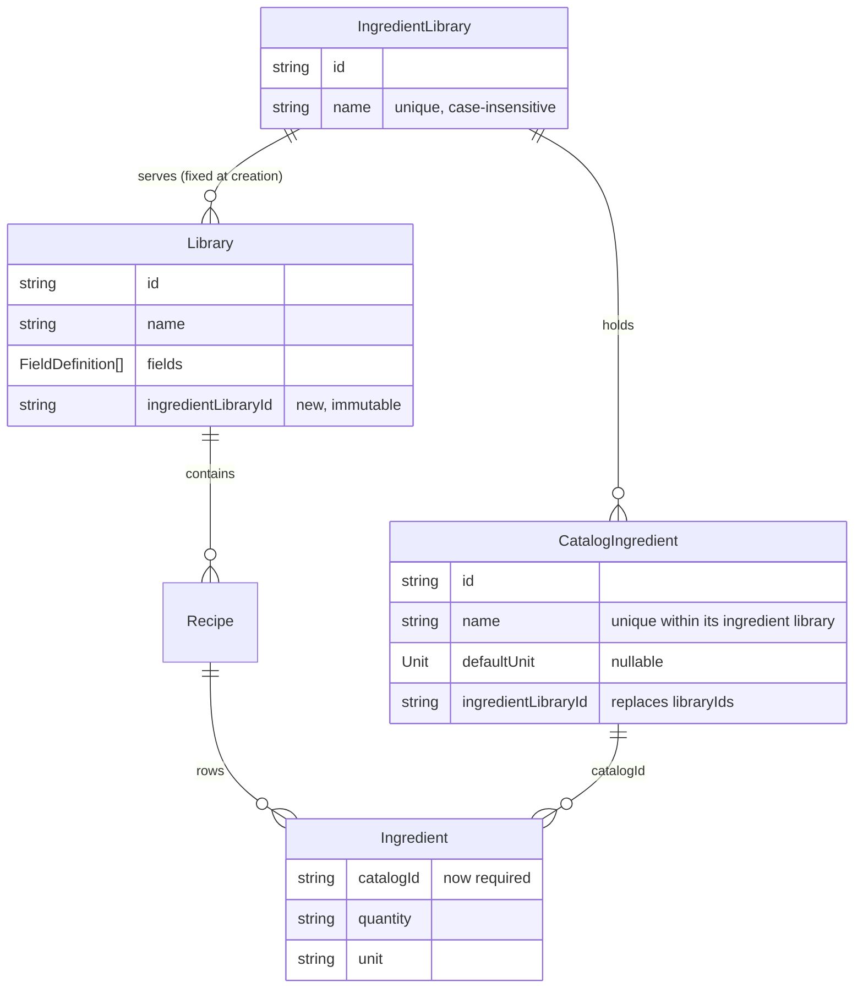

## feat: add ingredient libraries - Standard

> Source: `docs/brainstorm/2026-10-17-ingredient-libraries-brainstorm-doc.md`. The brainstorm's
> key decisions are the requirement. This plan records how its open questions were settled
> and the decisions it leaves to implementation. It is a prerequisite for
> `docs/brainstorm/2026-10-17-starter-recipes-import-brainstorm-doc.md`.

## Overview

Named **ingredient libraries** replace the single global catalog. Every recipe library points
at exactly one ingredient library, chosen when the recipe library is created and fixed after
that. Several recipe libraries can share one ingredient library. Ingredients in different
ingredient libraries are unrelated even when they share a name.

The Ingredients screen switches between ingredient libraries and can create, rename and
delete them. An ingredient can be copied or moved to another ingredient library. Some edits
reach recipes the user is not looking at: a rename that shows up in another recipe library,
and a move or delete that strips rows from recipes. Before applying one of those, the app
shows a dialog listing the recipes affected.

Recipe rows stop being free text. Every row references an ingredient in its recipe library's
ingredient library.

## Problem Statement / Motivation

- One global catalog mixes cocktail and coffee ingredients. Each `CatalogIngredient` carries a
  `libraryIds` scope, which means a picker with an "other libraries" section, scope-widening
  writes the user never asked for, and an ingredient handover whenever a library is deleted.
- Ingredient names are unique globally. *Lime juice* for the bar and *Lime juice* for a coffee
  shelf cannot both exist as separate entities.
- The starter recipes import has to resolve its ingredients into a well-defined set: the
  target recipe library's own ingredient library.
- Free-text rows and linked rows behave differently. A rename reaches only the linked ones,
  and a deleted entry leaves rows showing a stale name. One rule for every row removes that
  split.

## Proposed Solution

### Decisions locked with the user

| Topic | Decision |
|---|---|
| Copy and move | One ingredient at a time, from the ingredient editor sheet. No selection mode in v1. **Move is a copy followed by a delete, in one atomic storage call:** the moved ingredient gets a new id in the target library. |
| Default-unit change | Never warns. `defaultUnit` only prefills a newly picked row, so changing it alters no saved recipe. **Only a rename** warns, and only when it reaches recipes in a recipe library other than the active one. |
| Unmatched row name | Validation fails with "Pick or create an ingredient" and the save is refused. The picker's existing *New ingredient* action is the fix. Nothing is created on save. |
| Managing ingredient libraries | A switcher popover in the Ingredients screen header, like `LibrarySwitcher`: the list of ingredient libraries, then *New*, *Rename* and *Delete* items. No new screen. |
| Deleting an unused ingredient | The destructive confirm stays. A used ingredient gets the impact dialog instead, never both. |
| Impact dialog button | Rename uses a primary *Continue anyway* button. Move and delete strip rows, so they use the destructive button. |

### Open questions from the brainstorm, settled here

| Question | Answer |
|---|---|
| Ingredient library names unique globally? | **Yes**, case-insensitive, with `IngredientLibraryNameTakenException`. Recipe library names are a separate namespace, so a *Cocktails* recipe library and a *Cocktails* ingredient library coexist. |
| A recipe left with no ingredients | Allowed. The editor only requires a name. The dialog does not call this case out. |
| Templates seed ingredients? | No. A new ingredient library starts empty, and the starter import fills it. |
| Delete-library sheet successor picker | **Removed from the sheet.** `deleteLibrary(id, successorId:)` keeps its parameter, but it now only names the next active library. The sheet passes the first other library in creation order. The sheet adds a line saying the ingredient library stays. |
| `docs/known-issues.md` | Updated in phase 3 (see *Docs*). |

### Decisions made in this plan

- **`Ingredient` (a recipe row) drops `name`, and `catalogId` becomes required.** A row renders
  its ingredient's current name, so a rename reaches every row. A dangling id can only come
  from corrupt storage. It is hidden on render (`?.name`, skipped on null). **Accepted
  exception to "hidden, never rewritten":** the editor opens such a row blank, and blank rows
  are dropped, so the next save of that recipe removes it. Nothing else rewrites it.
- **`saveRecipe` checks its rows.** Every `catalogId` must resolve to an ingredient in the
  recipe library's ingredient library. If one doesn't, `saveRecipe` throws
  `IngredientNotFoundException`, and throws `LibraryNotFoundException` when the recipe library
  itself is missing. This catches an editor left open across a move or delete, and protects
  the starter import later.
- **The repository recomputes every cascade from its own state.** `moveIngredient` and
  `deleteIngredient` decide which rows to remove inside `_serialized`. The dialog's list is
  informational only and is never passed down.
- **Creating a recipe library with *Create new* is one call.** It becomes
  `saveLibrary(library, ingredientLibrary: …)`, which writes the ingredient library first,
  then the library, then emits once. A failure part-way leaves no half-created pair.
- ***Create new* names the ingredient library after the recipe library**, with no second name
  field. If an ingredient library already has that name, the name field shows an error that
  suggests choosing it from the list instead. Ingredient libraries can be renamed later from
  the Ingredients screen. The default selection is *Create new*.
- **The link between a recipe library and its ingredient library is visible.** The library
  tile's subtitle shows the ingredient library name. In rename mode, the library editor shows
  it read-only.
- **The Ingredients screen opens on the active recipe library's ingredient library.** Which
  ingredient library is selected lives in widget state and resets each time the screen
  opens. Switching here never changes the active recipe library. If the selected ingredient
  library disappears, the screen falls back to the active recipe library's.
- **Copy needs no new storage call.** The sheet builds the copy (a new `CatalogIngredient` with
  the same name and unit in the target library) and dispatches `RecipesIngredientCopied(copy)`.
  The bloc calls `saveIngredient` on it, with no lookup and no missing-entry branch. Copy still
  has its own event and mutation kind, so the sheet's listener can tell a copy from a save.
- **Preconditions are documented, not guarded.** No UI path can save an existing ingredient
  under a different `ingredientLibraryId`, change a library's `ingredientLibraryId` on replace,
  or move an ingredient into its own library. The doc comments state these as preconditions,
  and there is no `ArgumentError` branch to test. A move into the source fails on its own with
  `IngredientNameTakenException`, because the source entry already holds the name.
- **Name clashes on copy or move are refused before dispatch**, with `showRefusalToast`
  naming the target library. A failed mutation cannot say why it failed, so the UI checks
  first. This is the pattern the old in-use refusal used.
- **Copy and move close the editor sheet on success.** They act on the stored entry, not on
  unsaved edits in the form.
- **The impact list is text in the dialog's description.** It shows one line per recipe
  library, such as `Cocktails: Negroni, Martinez`, in creation order. The list is cut off
  after the first 10 recipes (`take(10)`), followed by one plural "and N more" string. It
  never scrolls, and `showConfirmDialog` gains no widget slot.
- **Reseed.** `kSchemaVersion` goes to `3`. Any stored version below 3, or none at all,
  reseeds every key: two recipe libraries and two ingredient libraries, all named
  *Cocktails* and *Coffee*, plus empty recipes and ingredients. The stale
  `__ingredients_import_version_key__` is left in place: nothing reads it, and `_write` has
  no remove path. Existing installs are not migrated (WIP rule).
- **Restore keeps one invariant: every library resolves its ingredient library.** When an
  `ingredientLibraryId` resolves to nothing (an unreadable blob), the ingredient library is
  recreated **under that same id**, named after the first library using it, and written back.
  No library is rewritten, and the ingredients that point at that id stay reachable.
  Uniqueness is enforced on save, not on restore, so a clashing name is tolerated and can be
  renamed. Ingredients whose ingredient library still resolves to nothing are reported. This
  follows the same approach as the existing active-id fallback, so no layer above needs a
  null branch.

### Data model



### 1. Data layer (`packages/`)

**`packages/recipes_api`**

- [ ] `lib/src/models/ingredient_library.dart` (new): `IngredientLibrary({required String name, String? id})`,
  json_serializable, Equatable, with a blank-name assert, the trimmed name and a uuid when no
  id is given. Export it from `models.dart`.
- [ ] `lib/src/models/catalog_ingredient.dart`: replace `libraryIds` with
  `required String ingredientLibraryId` (non-blank assert). Update the doc comments: names are
  unique within the ingredient library.
- [ ] `lib/src/models/library.dart`: add `required String ingredientLibraryId` (non-blank
  assert) and add it to `props`.
- [ ] `lib/src/models/ingredient.dart`: remove `name`, make `catalogId` a required non-blank
  `String`, and drop `includeIfNull`.
- [ ] `lib/src/models/recipes_snapshot.dart`: add `ingredientLibraries`, remove
  `ingredientsImported`.
- [ ] `lib/src/templates/library_templates.dart`: `cocktails` and `coffee` take
  `{required String ingredientLibraryId}`. `all()` returns each template paired with an
  `IngredientLibrary` of the same name, `List<(Library, IngredientLibrary)>`. The pair's id
  comes from `idBuilder`, so tests stay deterministic.
- [ ] `lib/src/recipes_api.dart`, contract changes:
  - `saveRecipe`: also throws `LibraryNotFoundException` and `IngredientNotFoundException`
    (see *Decisions*).
  - `saveIngredient`: names are unique **within** `ingredientLibraryId`. Throws
    `IngredientLibraryNotFoundException` when that library is missing. Precondition: an
    existing id keeps its `ingredientLibraryId`, because moves go through `moveIngredient`.
  - `deleteIngredient(id)`: also removes every row referencing `id` from every recipe. It no
    longer refuses.
  - **new (phase 3)** `moveIngredient(String id, {required String ingredientLibraryId})`: adds
    a new entry with the same name and default unit to the target, removes the source, and
    strips every row referencing `id`. Throws `IngredientNotFoundException`,
    `IngredientLibraryNotFoundException` and `IngredientNameTakenException`.
  - **new (phase 2)** `saveIngredientLibrary(IngredientLibrary)`: throws
    `IngredientLibraryNameTakenException`.
  - **new (phase 2)** `deleteIngredientLibrary(String id)`: removes the library and its
    ingredients. Throws `IngredientLibraryNotFoundException`, and
    `IngredientLibraryInUseException(id)` while any library references it.
  - `saveLibrary(library, {IngredientLibrary? ingredientLibrary, optionRenames})`: a given
    `ingredientLibrary` is created alongside `library`, which must point at it. Throws
    `IngredientLibraryNameTakenException`, and `IngredientLibraryNotFoundException` when
    `library.ingredientLibraryId` resolves to neither a stored library nor the given one.
    Precondition: a replace keeps `ingredientLibraryId` and passes no `ingredientLibrary`.
  - `deleteLibrary(id, {successorId})`: `successorId` only names the next active library.
    Ingredients are untouched.
  - Remove `importIngredients` and `IngredientInUseException`, including every doc comment
    that mentions them. Add `IngredientLibraryNotFoundException`,
    `IngredientLibraryNameTakenException` and `IngredientLibraryInUseException`, written like
    the existing exceptions.
- [ ] Regenerate with `dart run build_runner build --delete-conflicting-outputs`.

**`packages/local_storage_recipes_api/lib/src/local_storage_recipes_api.dart`**

- [ ] Add a `kIngredientLibrariesKey` key and set `kSchemaVersion = 3`. Remove
  `kIngredientsImportVersionKey`, `kIngredientsImportVersion`, `importIngredients`, `_linked`
  and `_withoutLibrary`.
- [ ] `_restore`: reseed every key when the version is below 3 or missing. Add
  `_readIngredientLibraries` (recovers as an empty list and reports), then recreate missing
  ingredient libraries under their ids using the invariant above. Update
  `_reportDanglingIngredientRefs` to say the rows are hidden.
- [ ] `_merged`: check name clashes only against entries with the same
  `ingredientLibraryId`.
- [ ] Add a `_stripped(recipes, ingredientId)` helper that returns recipes without the rows
  referencing the ingredient. `deleteIngredient` uses it in phase 1, and `moveIngredient`
  reuses it in phase 3.
- [ ] Write ordering is children first, then one `_emit`, as in `deleteLibrary`:
  - `deleteIngredient`, `moveIngredient`: recipes, then ingredients. A failure after the first
    write leaves rows removed but the ingredient still in its source, which still renders.
  - `deleteIngredientLibrary`: ingredients, then ingredient libraries.
  - `saveLibrary` with a new ingredient library: ingredient libraries, then recipes if
    conformed, then libraries.
- [ ] `_emit` gains `ingredientLibraries`.

**`packages/recipes_repository`**

- [ ] `lib/src/recipes_repository.dart`: one pass-through per new or changed api method,
  carrying the api's doc comment.
- [ ] `lib/recipes_repository.dart`: export `IngredientLibrary` and the three new exceptions,
  and drop `IngredientInUseException`.

### 2. Bloc (`lib/recipes/bloc/`)

- [ ] **State** (`recipes_state.dart`):
  - add `ingredientLibraries`, and remove `ingredientsImported`, `ImportableIngredient`,
    `importableIngredients`, `ingredientCountOnlyIn`, `libraryIngredients`,
    `otherLibraryIngredients` and `libraryIdsUsingIngredient`;
  - add `ingredientLibraryById(id)`, `ingredientLibraryNamed(name)`,
    `ingredientsIn(ingredientLibraryId)` (sorted case-insensitively) and
    `librariesUsingIngredientLibrary(id)` (in creation order);
  - add `recipesUsingIngredient(ingredientId, {String? exceptLibraryId})`, sorted by library
    creation order, then by name. This is the pure impact function the dialogs read;
  - `ingredientNamed(name, {required String ingredientLibraryId})` is now scoped.
- [ ] **Events** (`recipes_event.dart`):
  - remove `RecipesIngredientsImported` and `RecipesIngredientScopeWidened`;
  - `RecipesLibrarySaved` gains `IngredientLibrary? ingredientLibrary`;
  - add `RecipesIngredientLibrarySaved(IngredientLibrary)` and
    `RecipesIngredientLibraryDeleted(id)` in phase 2, and `RecipesIngredientCopied(CatalogIngredient copy)`
    and `RecipesIngredientMoved(ingredientId, {required ingredientLibraryId})` in phase 3.
- [ ] **`RecipesMutation`**: remove `ingredientsImported`, and add `ingredientCopied`,
  `ingredientMoved`, `ingredientLibrarySaved` and `ingredientLibraryDeleted`.
- [ ] **Handlers** (`recipes_bloc.dart`): each new handler is `sequential()` and has the same
  shape as the others: loading, then success or failure, naming its own kind on every
  emission.
  - `_onSubscriptionRequested` maps `snapshot.ingredientLibraries` and drops
    `ingredientsImported`.
  - Remove `_onIngredientsImported` and `_onIngredientScopeWidened`, along with their `on<>`
    registrations.
  - `_onIngredientCopied` calls `saveIngredient(event.copy)`.
  - `_onIngredientDeleted` drops the `IngredientInUseException` catch.
  - `_onRecipeSaved` adds catches for `IngredientNotFoundException` and
    `LibraryNotFoundException`.
  - `_onLibrarySaved` adds catches for `IngredientLibraryNameTakenException` and
    `IngredientLibraryNotFoundException`.
  - `_onFieldDeleted` and `_onFieldMoved` pass `ingredientLibraryId` through when they rebuild
    the `Library`. So does `lib/libraries/widgets/field_editor_sheet.dart`, which builds a
    `Library` when it saves a field. The required parameter makes the compiler find each of
    these sites.

### 3. Presentation

**Recipe editor**

- [ ] `lib/recipes/widgets/ingredient_picker.dart`: takes `ingredientLibraryId` and offers
  only `state.ingredientsIn(ingredientLibraryId)`. Remove `CatalogOption.inScope`, the
  *other libraries* section and the scope widening. Add a `validator`: a non-blank name with
  no match gets `recipeEditorIngredientUnknownError`.
- [ ] `lib/recipes/widgets/ingredient_row_field.dart`: `ingredientIn(state, {required
  ingredientLibraryId})` returns `null` for a blank name or a name that matches nothing. The
  validator has already refused the second case. `IngredientRowField` passes
  `ingredientLibraryId` down.
- [ ] `lib/recipes/widgets/ingredient_create_sheet.dart`: takes `ingredientLibraryId`. Reuse
  and create both happen in that ingredient library, with no scope widening. The reuse note
  names the ingredient library.
- [ ] `lib/recipes/view/recipe_editor_page.dart`: pass `widget.library.ingredientLibraryId`
  through. When an ingredient row fails validation, the "scroll to first invalid" pass
  includes it. A row whose entry no longer resolves opens blank.
- [ ] `lib/recipes/view/recipe_details_page.dart`: a row renders
  `state.ingredientById(catalogId)?.name` and is skipped when that resolves to nothing.

**Recipe libraries**

- [ ] `lib/libraries/widgets/library_editor_sheet.dart`:
  - Create mode adds an `FSelect` labelled *Ingredients*, with *New ingredient library* (the
    default) followed by every existing ingredient library, sorted.
  - When *New* is selected, the name validator also refuses a name that already belongs to an
    ingredient library, using `libraryEditorIngredientLibraryTakenError`.
  - Saving dispatches `RecipesLibrarySaved(library, ingredientLibrary: newOrNull)`.
  - Rename mode shows the ingredient library's name read-only.
  - Template fields come from `_templates.cocktails(ingredientLibraryId: …).fields`.
- [ ] `lib/libraries/widgets/library_delete_sheet.dart`: remove the ingredient count and the
  successor select, and pass `_others.first.id`. Add
  `libraryDeleteIngredientLibraryKept(name)`: "Its ingredients stay in {ingredientLibrary}."
- [ ] `lib/libraries/view/libraries_view.dart`: the tile subtitle gains the ingredient
  library's name. Update the `_delete` doc comment, since the successor no longer takes
  ingredients.

**Ingredients screen**

- [ ] `lib/ingredients/widgets/ingredient_library_switcher.dart` (new): an `FPopoverMenu`
  title showing the selected ingredient library's name, with a check on the selected entry
  in the list. A second group holds *New ingredient library*, *Rename {name}* and *Delete
  {name}*. It is callback-driven (`onSelected`, `onCreate`, `onRename`, `onDelete`) because
  the selection lives in the view's state, not the bloc.
- [ ] `lib/ingredients/widgets/ingredient_library_editor_sheet.dart` (new): creates or renames
  an ingredient library, with a single name field. The name validator uses
  `ingredientLibraryNamed`. It listens for `ingredientLibrarySaved` and pops the saved
  `IngredientLibrary`, so the view can select a library it just created.
- [ ] `lib/ingredients/view/ingredients_view.dart`:
  - The selected id lives in state, defaults to the active recipe library's ingredient
    library, and falls back as described in *Decisions*.
  - Under the header, a caption names the recipe libraries using the selected ingredient
    library, or says none do.
  - The list shows `ingredientsIn(selected)`, and each tile's subtitle shows only the default
    unit.
  - Remove the import button and its listener, and revise the empty-state copy.
  - Deleting an ingredient library is refused with `showRefusalToast` (naming the recipe
    libraries that use it) while it is in use. Otherwise a destructive confirm states how
    many ingredients go with it. On success, the screen selects the active recipe library's
    ingredient library.
  - Add listeners for `ingredientLibraryDeleted` failures, which show a `FailureBanner`.
- [ ] `lib/ingredients/widgets/ingredient_editor_sheet.dart`:
  - Remove the library checkboxes and `_libraryIds`. The name validator is scoped to
    `entry.ingredientLibraryId`.
  - **Rename impact:** if the trimmed name changed and
    `recipesUsingIngredient(id, exceptLibraryId: activeLibraryId)` is non-empty, the impact
    dialog (primary button) runs first. *Cancel* keeps the sheet open, unsaved.
  - **Copy to… / Move to…**: two `FPopoverMenu` buttons listing every *other* ingredient
    library, hidden when there are none.
    - Each first checks for a name clash in the target with `ingredientNamed(name,
      ingredientLibraryId: target)` and shows a refusal toast if there is one.
    - Move also runs the impact dialog (destructive button) when `recipesUsingIngredient(id)`
      is non-empty.
    - Then it dispatches. The sheet wraps itself in two `RecipesMutationListener`s, one for
      `ingredientCopied` and one for `ingredientMoved`, because each listener takes a single
      kind. Each closes the sheet on success and shows a `FailureBanner` on failure.
- [ ] `lib/ingredients/widgets/ingredient_impact_dialog.dart` (new):
  `Future<bool> showIngredientImpactDialog({context, title, lead, recipes, confirmLabel,
  destructive})`. It composes `lead` and the grouped, capped list into the description, as
  described in *Decisions*, and is built on `showConfirmDialog`.
- [ ] `lib/ui/confirm_dialog.dart`: add `bool destructive = true`, which picks the confirm
  button's variant. Every existing caller stays unchanged.
- [ ] In-use delete on the Ingredients screen: the refusal toast is replaced by the impact
  dialog (destructive button, *Delete anyway*). An unused ingredient keeps the existing
  confirm.

**Localization (`lib/l10n/arb/app_en.arb`)**

- [ ] **Remove in phase 1,** along with their `@` metadata:
  `ingredientPickerOtherLibrariesLabel`, `ingredientsImportLabel`, `ingredientsImportFailure`,
  `ingredientEditLibrariesLabel`, `ingredientEditLibrariesRequiredError`,
  `libraryDeleteIngredientCount` and `libraryDeleteSuccessorLabel`.
- [ ] **Remove in phase 3,** once the in-use refusal toast is gone:
  `ingredientsDeleteRefusalTitle`, `ingredientsDeleteRefusalDescription` and
  `ingredientsDeleteRefusalDescriptionNoLibraries`.
- [ ] **Revise:** `ingredientsDeleteDialogDescription`, `ingredientCreateReuseNote` and
  `ingredientsEmptyDescription`, so they no longer mention "catalog".
- [ ] **Add:** the strings for the switcher, the ingredient library sheet, the used-by
  caption, the ingredient library delete confirm and refusal, the library editor's
  *Ingredients* select and taken error, the delete-sheet line, the copy and move buttons and
  their clash refusals, the copy and move failure banners, the three impact dialogs (title,
  description, *Continue anyway* or *Delete anyway* or *Move anyway*, "and N more" plural),
  and `recipeEditorIngredientUnknownError`. Each key follows the screen-prefix naming that is
  already in the file.

### Tests

Every changed file keeps its test file in step. 100% coverage holds in the app and in all
three packages. CI's `dart_package.yml` and `flutter_package.yml` both default to
`min_coverage: 100`.

- `packages/recipes_api/test/src/models/ingredient_library_test.dart` (new), plus
  `catalog_ingredient_test.dart`, `library_test.dart`, `ingredient_test.dart`,
  `recipes_snapshot_test.dart` and `templates/library_templates_test.dart`: JSON round-trip,
  asserts, and `all()` pairing each template with a same-named ingredient library whose id
  comes from `idBuilder`.
- `packages/recipes_api/test/src/recipes_api_test.dart`: `toString` tests for the three new
  exceptions, and remove the `IngredientInUseException` group.
- `packages/local_storage_recipes_api/test/src/local_storage_recipes_api_test.dart`:
  - a fresh install and a version-2 store both reseed to v3, with two pairs;
  - an unreadable ingredient libraries blob is recovered by recreating each referenced
    ingredient library under its id, named after its first library, and written back. The
    ingredients stay reachable, and the libraries blob is not rewritten;
  - name uniqueness is per ingredient library: the same name in two libraries succeeds, and
    the same name in one library throws;
  - `saveRecipe` refuses an id that is unknown or that belongs to another ingredient library;
  - `deleteIngredient` and `moveIngredient` strip rows across every recipe library sharing
    the source, write recipes before ingredients, emit once, and throw where specified;
  - `deleteIngredientLibrary` refuses while in use and otherwise removes the library's
    ingredients;
  - `saveLibrary` with an ingredient library writes it first, checks for a name clash, and
    refuses a changed `ingredientLibraryId`;
  - `deleteLibrary` leaves ingredients and ingredient libraries untouched.
- `packages/recipes_repository/test/src/recipes_repository_test.dart`: one delegation test per
  new method.
- `test/recipes/bloc/recipes_state_test.dart`: `ingredientsIn`, `ingredientNamed` scoping,
  `librariesUsingIngredientLibrary`, and `recipesUsingIngredient` with and without
  `exceptLibraryId`, including its ordering.
- `test/recipes/bloc/recipes_bloc_test.dart`, `recipes_event_test.dart`: every new handler's
  success and every failure catch; the new saveRecipe and saveLibrary catches; field delete and
  move keep `ingredientLibraryId`.
- `test/libraries/widgets/field_editor_sheet_test.dart`: a saved field keeps the library's
  `ingredientLibraryId`.
- `test/recipes/widgets/ingredient_picker_test.dart`, `ingredient_row_field_test.dart`,
  `ingredient_create_sheet_test.dart`, and `test/recipes/view/recipe_editor_page_test.dart`,
  `recipe_details_page_test.dart`: the picker offers only its ingredient library; an unknown
  name blocks the save and scrolls to the row; create reuses an entry within the library
  only; details skips a dangling row.
- `test/libraries/widgets/library_editor_sheet_test.dart`, `library_delete_sheet_test.dart`,
  and `test/libraries/view/libraries_view_test.dart`: New vs existing choice, the taken-name
  error, read-only rename display, no successor select, the kept-line text, and the tile
  subtitle.
- `test/ingredients/widgets/ingredient_library_switcher_test.dart` (new),
  `ingredient_library_editor_sheet_test.dart` (new) and `ingredient_impact_dialog_test.dart`
  (new), plus `test/ingredients/view/ingredients_view_test.dart`,
  `ingredient_editor_sheet_test.dart` and `test/ui/confirm_dialog_test.dart`:
  - the switcher's selection stays local and does not change the active library;
  - the fallback when the selected ingredient library is deleted;
  - delete refusal and confirm for an ingredient library;
  - a rename warns only for other recipe libraries, and a unit-only change never warns;
  - a move or in-use delete warns with the destructive variant;
  - a clash refusal toast on copy and move;
  - the dialog's per-library lines and its cut-off at 10 plus "and N more";
  - `destructive: false` renders a primary button.
- `test/helpers/fixtures.dart`: add `cocktailsPantry` and `coffeeShelf` `IngredientLibrary`
  fixtures, point the library fixtures at them, and rescope the ingredient fixtures. The
  shared `sugarIngredient` becomes two separate entries.

### Docs

- [ ] `docs/known-issues.md`:
  - In *A deleted library cannot be restored*, replace "Catalog ingredients are the exception…"
    with: the library's ingredient library stays and can be deleted from the Ingredients
    screen.
  - In *Ingredient names fold…*, say the fold applies within one ingredient library.
  - Add *A recipe library cannot change its ingredient library*: why (re-pointing is a mass
    relink that could strip every recipe) and closing it (a relink that maps rows by name).
  - Add *Copy and move work on one ingredient at a time*, and say a selection mode would close
    it.
- [ ] `docs/brainstorm/2026-10-17-starter-recipes-import-brainstorm-doc.md` is not edited. Its
  "Shared ingredient libraries" open question is answered here (no warning on additions).

## Technical Considerations

- **Architecture:** layering is unchanged. Presentation reaches the data packages only
  through `recipes_repository`'s export list. One bloc and one snapshot remain, as the
  ingredients-catalog brainstorm decided.
- **Atomicity:** every cascade is one `_serialized` mutation that writes children first and
  emits once. A crash part-way always leaves a state that renders.
- **Staleness:** the impact list is read from the snapshot when the user acts, so it can
  differ slightly from what the write removes. The write never removes more than the rule
  says, because it recomputes from storage.
- **Bloc overlap:** the new handlers are `sequential()` per kind, like the existing ones.
  Move and delete compute nothing from bloc state, so they cannot drop a concurrent edit.
  Copy reads the entry from state. The sheet that dispatches it is modal, which is the same
  guard the field handlers rely on.
- **Performance:** `recipesUsingIngredient` is O(recipes × rows) per call and runs once per
  user action, not per build. Tile usage counts still come from `ingredientUsage`, read once
  per build.
- **Security / data:** local storage only, with no new data leaving the device. The reseed
  wipes existing local data by design (WIP).

## Implementation Phases

### Phase 1: Ingredient libraries in the data model

- **Status:** Complete (not committed)
- **Scope:** Swaps the data model and leaves the app working on it. Includes:
  - the models, the reseed and restore, scoped uniqueness, `saveRecipe` validation, the
    `deleteIngredient` cascade and `saveLibrary(ingredientLibrary:)`;
  - the bloc state, and every event and handler change except the ones that phases 2 and 3
    add;
  - the scoped picker, create sheet and row validation, and the details page;
  - removal of the import, the scope widening, the library checkboxes and the successor
    picker;
  - the library editor always creating a new ingredient library.

  Two stopgaps are accepted knowingly, because each is a few lines of existing behaviour kept
  alive. The in-use delete refusal toast stays, driven by `recipesUsingIngredient`, until
  phase 3. The library editor always uses *Create new* until phase 2.

  Build it in internal checkpoints, in this order: recipes_api, then local storage and the
  repository, then the bloc, then the UI.
- **Files touched:**
  - `packages/recipes_api/lib/src/models/{ingredient_library,catalog_ingredient,library,ingredient,recipes_snapshot,models}.dart` and their `.g.dart` files
  - `packages/recipes_api/lib/src/{recipes_api.dart,templates/library_templates.dart}`
  - `packages/local_storage_recipes_api/lib/src/local_storage_recipes_api.dart`
  - `packages/recipes_repository/lib/{recipes_repository.dart,src/recipes_repository.dart}`
  - `lib/recipes/bloc/*`
  - `lib/recipes/widgets/{ingredient_picker,ingredient_row_field,ingredient_create_sheet}.dart`
  - `lib/recipes/view/{recipe_editor_page,recipe_details_page}.dart`
  - `lib/ingredients/view/ingredients_view.dart`
  - `lib/ingredients/widgets/ingredient_editor_sheet.dart`
  - `lib/libraries/widgets/{library_editor_sheet,library_delete_sheet,field_editor_sheet}.dart`
  - `lib/libraries/view/libraries_view.dart`
  - `lib/l10n/arb/app_en.arb`
  - every matching test, plus `test/helpers/fixtures.dart`
- **Acceptance criteria:**
  - A fresh install has two recipe libraries, each with its own ingredient library.
  - The picker offers only its library's ingredients.
  - An unknown row name blocks the save.
  - Deleting an unused ingredient works, and deleting a used one is refused with a toast.
  - Deleting a recipe library leaves its ingredients in place.
  - None of the removed code symbols remain. The refusal strings stay until phase 3.
- **Validation:** `(cd packages/recipes_api && dart run build_runner build --delete-conflicting-outputs && dart analyze && dart test) && (cd packages/recipes_repository && dart analyze && dart test) && (cd packages/local_storage_recipes_api && flutter analyze && flutter test) && flutter gen-l10n && dart format --output=none --set-exit-if-changed . && flutter analyze && dart run bloc_tools:bloc lint . && flutter test`

### Phase 2: Manage ingredient libraries and choose one per recipe library

- **Status:** Not started
- **Scope:** Adds the ingredient library switcher and its New, Rename and Delete items, the
  ingredient library editor sheet and the used-by caption on the Ingredients screen. Also
  adds the library editor's *Ingredients* select (New or existing), the read-only rename
  line, and the ingredient library name on library tiles. Adds `saveIngredientLibrary` and
  `deleteIngredientLibrary` through the api, storage and repository, plus the
  `ingredientLibrarySaved` and `ingredientLibraryDeleted` events and handlers.
- **Files touched:**
  - `packages/recipes_api/lib/src/recipes_api.dart`
  - `packages/local_storage_recipes_api/lib/src/local_storage_recipes_api.dart`
  - `packages/recipes_repository/lib/src/recipes_repository.dart`
  - `lib/ingredients/widgets/{ingredient_library_switcher,ingredient_library_editor_sheet}.dart` (new)
  - `lib/ingredients/view/ingredients_view.dart`
  - `lib/recipes/bloc/*`
  - `lib/libraries/widgets/library_editor_sheet.dart`
  - `lib/libraries/view/libraries_view.dart`
  - `lib/l10n/arb/app_en.arb`
  - matching tests
- **Acceptance criteria:**
  - Two recipe libraries can share one ingredient library, and its ingredients appear in
    both pickers.
  - Ingredient libraries can be created and renamed.
  - Deleting an ingredient library that is in use is refused with a toast naming the users.
  - Switching ingredient libraries never changes the recipe list's library.
- **Validation:** `(cd packages/recipes_repository && dart test) && (cd packages/local_storage_recipes_api && flutter test) && flutter gen-l10n && dart format --output=none --set-exit-if-changed . && flutter analyze && dart run bloc_tools:bloc lint . && flutter test`

### Phase 3: Impact warnings, copy and move

- **Status:** Not started
- **Scope:** Adds `moveIngredient` through the api, storage and repository, and the
  `destructive` parameter on `showConfirmDialog`. Adds the impact dialog, the rename warning,
  and the in-use delete through the impact dialog, replacing the refusal toast and its
  strings. Adds copy and move from the editor sheet with clash refusals, the
  `ingredientCopied` and `ingredientMoved` events and handlers, and the known-issues update.
- **Files touched:**
  - `packages/recipes_api/lib/src/recipes_api.dart`
  - `packages/local_storage_recipes_api/lib/src/local_storage_recipes_api.dart`
  - `packages/recipes_repository/lib/src/recipes_repository.dart`
  - `lib/ui/confirm_dialog.dart`
  - `lib/ingredients/widgets/{ingredient_impact_dialog,ingredient_editor_sheet}.dart`
  - `lib/ingredients/view/ingredients_view.dart`
  - `lib/recipes/bloc/*`
  - `lib/l10n/arb/app_en.arb`
  - `docs/known-issues.md`
  - matching tests
- **Acceptance criteria:**
  - A rename warns only when another recipe library uses the ingredient.
  - A move or delete of a used ingredient lists the recipes, and continuing strips their rows.
  - A copy or move onto a taken name is refused with a toast.
  - A unit-only change never warns.
- **Validation:** `(cd packages/recipes_repository && dart test) && (cd packages/local_storage_recipes_api && flutter test) && flutter gen-l10n && dart format --output=none --set-exit-if-changed . && flutter analyze && dart run bloc_tools:bloc lint . && flutter test`

## Success Criteria

> The `verify:` commands use POSIX subshells and `!`, so run them under bash or zsh, for
> example `bash -c '…'`. They do not work as typed in fish.

```success-criteria
GOAL: Ingredients live in named ingredient libraries, each recipe library points at exactly one (fixed at creation, possibly shared), every recipe row references an ingredient in that library, and edits that reach other recipes are announced before they apply.

SUCCESS CRITERIA:
- The three packages analyze cleanly and their tests pass, generated code included | verify: (cd packages/recipes_api && dart run build_runner build --delete-conflicting-outputs && dart analyze && dart test) && (cd packages/recipes_repository && dart analyze && dart test) && (cd packages/local_storage_recipes_api && flutter analyze && flutter test)
- Localized strings generate and the app analyzes cleanly | verify: flutter gen-l10n && flutter analyze
- Code is formatted | verify: dart format --output=none --set-exit-if-changed .
- Bloc lints pass | verify: dart run bloc_tools:bloc lint .
- App, bloc and widget tests pass, covering every case under "Tests" | verify: flutter test
- The ingredient library model exists and the schema version is 3 | verify: grep -q "class IngredientLibrary " packages/recipes_api/lib/src/models/ingredient_library.dart && grep -q "kSchemaVersion = 3" packages/local_storage_recipes_api/lib/src/local_storage_recipes_api.dart
- The global-catalog machinery is gone, comments included | verify: ! grep -rq "\.libraryIds\|libraryIds:\|importIngredients\|IngredientInUseException\|ingredientsImported\|IngredientsImported\|ImportableIngredient\|importableIngredients\|libraryIngredients\|kIngredientsImportVersion\|RecipesIngredientScopeWidened\|_withoutLibrary\|_linked\|inScope\|ingredientCountOnlyIn\|otherLibraryIngredients\|libraryIdsUsingIngredient" lib/recipes lib/ingredients lib/libraries lib/ui packages/recipes_api/lib packages/local_storage_recipes_api/lib packages/recipes_repository/lib
- The confirm dialog has a non-destructive variant and the impact dialog is built on it | verify: grep -q "showConfirmDialog" lib/ingredients/widgets/ingredient_impact_dialog.dart && grep -q "bool destructive" lib/ui/confirm_dialog.dart
- Removed strings and their metadata are gone | verify: ! grep -q '"@\?\(ingredientPickerOtherLibrariesLabel\|ingredientsImportLabel\|ingredientsImportFailure\|ingredientsDeleteRefusalTitle\|ingredientsDeleteRefusalDescription\|ingredientsDeleteRefusalDescriptionNoLibraries\|ingredientEditLibrariesLabel\|ingredientEditLibrariesRequiredError\|libraryDeleteIngredientCount\|libraryDeleteSuccessorLabel\)"' lib/l10n/arb/app_en.arb
- Presentation never imports a data package directly | verify: ! grep -rq "package:local_storage_recipes_api\|package:recipes_api" lib/recipes lib/ingredients lib/libraries lib/app lib/ui
- Known issues reflect the new model | verify: ! grep -q "Catalog ingredients are the exception" docs/known-issues.md && grep -q "within one ingredient library" docs/known-issues.md && grep -q "cannot change its ingredient library" docs/known-issues.md && grep -q "one ingredient at a time" docs/known-issues.md
- Coverage is 100% in the app and in all three packages | verify: manual 1) run the very_good_cli MCP `test` tool with min_coverage 100 at the repo root 2) run it for packages/recipes_api, packages/recipes_repository and packages/local_storage_recipes_api 3) confirm all four report 100%
- The feature works end to end on a device | verify: manual 1) uninstall, then run `flutter run --flavor development --target lib/main_development.dart` 2) open Ingredients from Cocktails and confirm the switcher shows the Cocktails ingredient library and the caption names Cocktails 3) write a recipe, type "Gin" into a row without creating it, tap save, and confirm the row says to pick or create an ingredient and the save is refused 4) create Gin through New ingredient, save, and confirm the details page shows Gin 5) on Libraries, create "Summer" choosing Cocktails under Ingredients, confirm its tile subtitle names Cocktails, then add a Summer recipe using Gin 6) switch back to Cocktails, open Ingredients, rename Gin to "London dry gin", and confirm a primary-button dialog lists the Summer recipe only; continue and confirm both recipes show the new name 7) change Gin's default unit only and confirm no dialog appears 8) create ingredient library "Bar shelf" from the switcher, open London dry gin, Copy to Bar shelf, then Copy to Bar shelf again and confirm a toast refuses the clash 9) Move London dry gin to Coffee, confirm a destructive dialog lists both recipes, continue, and confirm both recipes lost that row 10) delete an unused ingredient and confirm the plain delete confirm appears 11) try to delete the Cocktails ingredient library and confirm a toast names Cocktails and Summer; delete Bar shelf and confirm the screen returns to Cocktails' ingredient library 12) delete the Summer recipe library and confirm the sheet says its ingredients stay and offers no successor select 13) kill and relaunch the app and confirm everything held

NON-GOALS:
- Multi-select copy or move, or a selection mode on the Ingredients screen
- Changing a recipe library's ingredient library after creation
- Migrating existing installs; v2 data is discarded by the reseed
- Seeding ingredients into new or template-based ingredient libraries
- A warning on adding an ingredient, or on a default-unit change
- Undo for row removal, or a recently-deleted area
- The starter recipes import itself, and unique recipe names
- A separate name field for a new ingredient library in the library editor

VERIFICATION COMMAND: (cd packages/recipes_api && dart run build_runner build --delete-conflicting-outputs && dart analyze && dart test) && (cd packages/recipes_repository && dart analyze && dart test) && (cd packages/local_storage_recipes_api && flutter analyze && flutter test) && flutter gen-l10n && dart format --output=none --set-exit-if-changed . && flutter analyze && dart run bloc_tools:bloc lint . && flutter test && grep -q "class IngredientLibrary " packages/recipes_api/lib/src/models/ingredient_library.dart && grep -q "kSchemaVersion = 3" packages/local_storage_recipes_api/lib/src/local_storage_recipes_api.dart && ! grep -rq "\.libraryIds\|libraryIds:\|importIngredients\|IngredientInUseException\|ingredientsImported\|IngredientsImported\|ImportableIngredient\|importableIngredients\|libraryIngredients\|kIngredientsImportVersion\|RecipesIngredientScopeWidened\|_withoutLibrary\|_linked\|inScope\|ingredientCountOnlyIn\|otherLibraryIngredients\|libraryIdsUsingIngredient" lib/recipes lib/ingredients lib/libraries lib/ui packages/recipes_api/lib packages/local_storage_recipes_api/lib packages/recipes_repository/lib && grep -q "showConfirmDialog" lib/ingredients/widgets/ingredient_impact_dialog.dart && grep -q "bool destructive" lib/ui/confirm_dialog.dart && ! grep -q '"@\?\(ingredientPickerOtherLibrariesLabel\|ingredientsImportLabel\|ingredientsImportFailure\|ingredientsDeleteRefusalTitle\|ingredientsDeleteRefusalDescription\|ingredientsDeleteRefusalDescriptionNoLibraries\|ingredientEditLibrariesLabel\|ingredientEditLibrariesRequiredError\|libraryDeleteIngredientCount\|libraryDeleteSuccessorLabel\)"' lib/l10n/arb/app_en.arb && ! grep -rq "package:local_storage_recipes_api\|package:recipes_api" lib/recipes lib/ingredients lib/libraries lib/app lib/ui && ! grep -q "Catalog ingredients are the exception" docs/known-issues.md && grep -q "within one ingredient library" docs/known-issues.md && grep -q "cannot change its ingredient library" docs/known-issues.md && grep -q "one ingredient at a time" docs/known-issues.md
```

## Success Metrics

- The starter-recipes import plan can resolve ingredients against
  `library.ingredientLibraryId` with no further change to the data model.
- No code path can store a recipe row that references nothing, or an ingredient from another
  ingredient library. `saveRecipe` refuses it and the editor validates it.
- Every action that strips rows or renames rows in another recipe library is preceded by a
  dialog listing them.

## Dependencies & Risks

- **Branch:** the current branch is `feat/starter-recipes-import`. This work must merge before
  the starter import does, so it belongs on its own branch, such as `feat/ingredient-libraries`.
- **Phase 1 is large.** The model swap touches all three packages and most ingredient UI at
  once, because nothing compiles part-way. To keep it reviewable, phase 1 brings in no new
  UI: only removals and rescoping.
- **Reseed wipes local data** on every existing install, including the developer's own. This
  is accepted under the WIP rule. Say so in the PR description.
- **Moving changes the ingredient's id.** Nothing outside rows references ingredient ids, so
  this is safe. The starter import must not cache ingredient ids across a move.
- **Fixture churn:** `sugarIngredient` is shared across two libraries today, and many widget
  tests use it. Splitting it touches tests well beyond the ingredient ones.
- **Undocumented-precondition misuse:** the storage layer does not stop a caller from saving
  an existing ingredient under another ingredient library, which would bypass the row strip.
  No UI does this. The starter import must create ingredients rather than re-home them.
- **`deleteLibrary` keeps `successorId`** only to name the next active library. Letting the
  storage layer pick one would remove the parameter from the event, the bloc and the sheet.
  That was left out to limit churn, and it is a candidate cleanup.

## References & Research

- Brainstorm: `docs/brainstorm/2026-10-17-ingredient-libraries-brainstorm-doc.md`.
  Dependent: `docs/brainstorm/2026-10-17-starter-recipes-import-brainstorm-doc.md`.
- Atomic cascade and write ordering to copy: `deleteLibrary` in
  `packages/local_storage_recipes_api/lib/src/local_storage_recipes_api.dart`.
- Uniqueness rule to scope: `_merged`, in the same file.
- Restore and fallback pattern: `_restore`, in the same file.
- Usage helpers that become `recipesUsingIngredient`: `ingredientUsage` and
  `libraryIdsUsingIngredient` in `lib/recipes/bloc/recipes_state.dart`.
- Pre-dispatch refusal pattern: `_delete` in `lib/ingredients/view/ingredients_view.dart`.
- Switcher to mirror: `lib/recipes/widgets/library_switcher.dart`.
- Dialog to extend: `lib/ui/confirm_dialog.dart`.
- Row linking to replace: `IngredientRowControllers.ingredientIn` in
  `lib/recipes/widgets/ingredient_row_field.dart`.
- Prior plan whose conventions this follows:
  `docs/plan/2026-10-11-feat-reorder-fields-and-close-ui-known-issues-plan.md`.
- No external research: local-only persistence with strong in-repo precedents.
