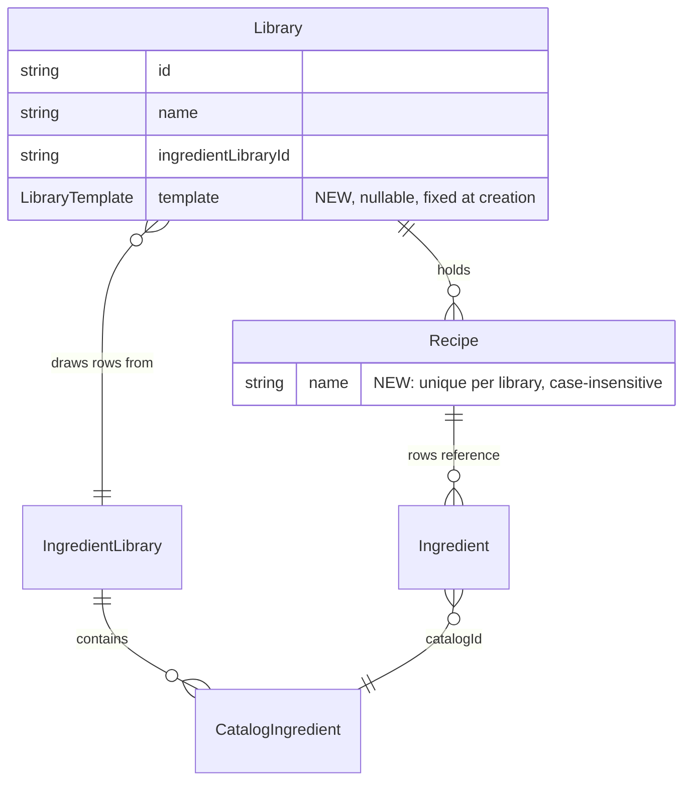

## feat: add starter recipes import - Standard

> Source: `docs/brainstorm/2026-10-17-starter-recipes-import-brainstorm-doc.md` (the flow).
> Its key decisions are the requirement, except the counts and the bundle shape, which
> `2026-11-06-starter-recipes-content-brainstorm-doc.md` supersedes. The content already
> shipped in `packages/starter_recipes` (5e92b50). This plan builds the import on top of it.

## Overview

A user inside a Cocktails or Coffee library opens a catalog of the bundled starter recipes
(42 cocktails, 12 coffees). They search it, tick recipes and tap `Import N`. The picked
recipes and every ingredient they need are written into that library in one mutation:

- An ingredient whose name matches an entry in the library's ingredient library (ignoring
  case) is linked to that entry.
- An ingredient with no match is created there.

Cocktails pick ml or oz at import time. Coffee is metric only.

Four supporting changes come with it:

1. `Library` gains a **template marker**. It is set when a library is created from the
   Cocktails or Coffee starting point, and it decides which set the catalog offers.
2. **Recipe names become unique per library**, ignoring case. This is enforced on save and
   on import, and the editor refuses a taken name inline.
3. A **rename sheet** resolves clashes between picked names and existing recipe names. The
   user renames or skips each clash before anything is written.
4. A new **`starter_recipes_repository`** package is the app's only route to the bundled
   content. It keeps the layering rule that presentation never reaches a data package.

## Problem Statement / Motivation

New libraries start empty. Typing 50 classics by hand is the main barrier to the app being
useful on day one. The bundle exists, but nothing reads it. Recipe names are not unique
today, so a naive import could silently duplicate `Negroni`.

## Proposed Solution

### Decisions locked with the user

- Rows already in the library show an `In library` badge. They **stay selectable**, and
  `Select all` **includes them**. Clashes go to the rename sheet.
- The rename sheet offers **Rename or Skip on each row**. A `Skip all` action exists because
  `Select all` can put many clashes in front of the user.
- **A `starter_recipes_repository` package** wraps `StarterRecipesLoader` and owns the
  mapping from bundle DTOs to domain models. The app depends on it, never on
  `starter_recipes`.
- **Phases in one plan.** The three phases below are each sized to be one PR.

### Open questions from the brainstorms, settled here

| Question | Answer |
|---|---|
| Asset location and loading | `packages/starter_recipes` keeps the JSON, the DTOs and `StarterRecipesLoader` (the data client). The new `packages/starter_recipes_repository` takes a loader, which `main_*.dart` builds with `rootBundle`. |
| Template marker shape | `enum LibraryTemplate { cocktails, coffee }` in `recipes_api`, stored as the nullable `Library.template`. It is **fixed at creation**, as a documented precondition of `saveLibrary` exactly like `ingredientLibraryId`. Every site that rebuilds a library passes it through. A heavily edited Cocktails library still offers the catalog, and unmatched values are dropped. |
| Mark rows already in the library? | Yes, with an `In library` badge (see the locked decisions). |
| Feedback for dropped field values | **Silent.** This is recorded in `docs/known-issues.md`. |
| Shared ingredient libraries | Additions do not warn. The import only adds, and never modifies an existing entry. |
| ml/oz for coffee | No toggle. Coffee rows are all counted (`quantity` + `unit`), so the system is irrelevant. |
| Default unit when importing in oz (Nov 6) | A created entry whose bundled default is `ml` gets `oz` when the import is imperial. Every other default is kept. |
| Entry point placement | Both: a header action on the recipe list, and a secondary button in the empty state. Each shows only when the active library has a template. |

### Decisions made in this plan

- **One enum, not two.** `LibraryTemplate` replaces `starter_recipes`' `StarterCollection`,
  which has the same values. `StarterRecipesLoader.load(LibraryTemplate)` keeps reading
  `assets/<template.name>/…`.
- **Name folding.**
  - A recipe name is a clash when it equals another name in the same library after
    trimming and ignoring case.
  - `Recipe` already trims `name`, so the API compares with
    `compareCaseInsensitive(a, b) == 0`. The UI uses the same fold through a new
    `RecipesState.recipeNamed`.
  - A recipe never clashes with itself, so renaming `mojito` to `Mojito` saves.
- **The editor refuses a taken name inline,** in `_validateName`. That matches how the
  library and ingredient editors show a name clash: as a validator error, not a toast. A
  `RecipeNameTakenException` that slips through (a race) lands on the existing save-failure
  banner.
- **`RecipesApi.importRecipes` only adds, and is the authority.**
  - Before writing anything it checks that:
    - the library exists;
    - new entries' names are free in the ingredient library and among themselves;
    - every row resolves to a stored or new entry in that ingredient library;
    - recipe names are free in the library and among the imported recipes.
  - It then writes ingredients, then recipes, and emits once.
  - Its documented preconditions follow the existing `saveIngredient` and `saveLibrary`
    style:
    - recipe and entry ids are not already stored;
    - every recipe's `libraryId` is the target library;
    - every entry's `ingredientLibraryId` is that library's.

    The repository's builder is the only caller, and it generates fresh ids.
  - A refused import writes nothing.
  - If the recipes write fails after the ingredients write succeeded, nothing is emitted.
    The new entries are on disk but not in memory. They appear only after a relaunch, as
    unused entries, and the next ingredient write erases them. `docs/known-issues.md`
    records this, and it narrows the brainstorm's "any failure writes nothing".
- **The mapping lives in `StarterRecipesRepository.buildImport`.** Turning bundle DTOs into
  domain `Recipe` and `CatalogIngredient` values is a repository's job. It runs inside the
  `RecipesBloc` handler against the bloc's state at handling time, so the picks are resolved
  against the freshest catalog. The API's validation catches anything that changed in
  between.
- **Field mapping.** A bundled field value maps onto the library field whose label matches it,
  ignoring case. The value is then handled by field type:
  - `select`: a `String` equal to an option, ignoring case, is stored in the option's own
    spelling.
  - `number`: takes a `num`.
  - `text` and `longText`: take a `String`.

  Anything else is dropped, as is a value whose label matches no field. The bundle is
  schema-tested against the templates, so no coercion is needed.
- **Tags are imported as written.** `libraryTags` already folds `sour` and `Sour` into one
  chip, and the tag filter ignores case.
- **Selection model.**
  - Selection is a set of recipe keys. It survives search, and the measure toggle does not
    change it.
  - `Import N` counts every selected recipe, including ones hidden by the search.
  - `Select all` selects every visible row. When every visible row is already selected, it
    becomes `Deselect all` and clears them.
- **Import flow.**
  1. Tapping `Import N` computes the clashes: picks whose name matches a recipe in the
     library. Bundle names are unique per set, so picks only clash with each other after a
     rename.
  2. If there are clashes, the rename sheet opens. It returns a map from recipe key to a new
     name, or to null when that recipe is skipped. The return value itself is null when the
     user cancels.
  3. The catalog dispatches `RecipesStarterRecipesImported`. While the import runs, the
     catalog disables `Import`. Leaving the page mid-import is harmless: the import still
     completes.
  4. On success, the catalog pops to the list. The bloc clears the search term and the tag
     filter, so the imported recipes are visible.
  5. On failure, the catalog stays open with a `FailureBanner` and keeps the selection. The
     renames are not kept, so the sheet reopens with the original names.
- **Rename sheet rules.**
  - Each row is prefilled with the original name, under the label "New name for {recipe}".
  - A row's name must be non-blank. It must also be free in the library and among the final
    names of every other pick that isn't skipped.
  - `Import` is enabled when every row is valid or skipped, and at least one recipe remains
    to import.
  - The first field takes focus when the sheet opens.
- **Catalog load failure** shows a centred message with no retry. The bundle is
  schema-tested, so a failure here is a bug, not a condition to recover from.
- **The measure system is per visit.** It defaults to ml every time the catalog opens and is
  not persisted.
- **Row subtitle.**
  - A cocktail shows the names of its first three ingredients.
  - A coffee shows its `Brew method` value. Most coffees share `Coffee beans, Water`, so
    their ingredients would not tell them apart.

### Data model



### Layering

```
starter_recipes (data: JSON, DTOs, loader) ─┐
                                            ├─► starter_recipes_repository ─┐
recipes_api ◄── local_storage_recipes_api   │                               ├─► app (blocs, views)
     └──────────────────────────────────────┴─► recipes_repository ─────────┘
```

### 1. Data layer (`packages/`)

`packages/recipes_api`
- [x] `lib/src/models/library_template.dart`: `@JsonEnum() enum LibraryTemplate { cocktails, coffee }`
  with doc comments. Export it from `models.dart`.
- [x] `lib/src/models/library.dart`: add `final LibraryTemplate? template` (an optional ctor
  param) and add it to `props`. Run `build_runner`.
- [x] `lib/src/templates/library_templates.dart`: `cocktails()` sets
  `template: LibraryTemplate.cocktails`, and `coffee()` sets `LibraryTemplate.coffee`.
- [x] `lib/src/recipes_api.dart`:
  - `RecipeNameTakenException(name)`.
  - `saveRecipe` docs gain the clash rule and the exception.
  - `saveLibrary`'s precondition becomes: "a replace keeps the stored `ingredientLibraryId`
    and `template`, and passes no [ingredientLibrary]."
  - New:
    ```dart
    /// Adds [ingredients] and [recipes] together, all into the library carrying
    /// [libraryId]. Nothing is stored when any of them is refused.
    Future<void> importRecipes({
      required String libraryId,
      required List<CatalogIngredient> ingredients,
      required List<Recipe> recipes,
    });
    ```
    The docs give the preconditions from *Decisions made in this plan* and list the
    throws: `LibraryNotFoundException`, `IngredientNameTakenException`,
    `IngredientNotFoundException`, `RecipeNameTakenException`, and
    `RecipesPersistenceException`.

`packages/local_storage_recipes_api`
- [x] `saveRecipe`: throw `RecipeNameTakenException` when a different recipe in the same
  library has the same name, compared with `compareCaseInsensitive`. Check this after the
  row check.
- [x] `importRecipes`, using the same `_serialized` pattern:
  1. Look up the library.
  2. Fold each new entry into the catalog through `_merged`, which already throws on a name
     clash.
  3. Check every row against the offered ids (stored and new) in the library's ingredient
     library.
  4. Check recipe names against the library and against each other.
  5. Write `kIngredientsKey` when entries were added, then `kRecipesKey`.
  6. Emit once.

  Add a comment on the write order: an entry with no rows renders, while a row whose entry
  is missing does not.
- [x] `kSchemaVersion = 5`, and extend the doc: "version 5 added library templates". This
  reseeds, so seeded libraries carry their marker (WIP, no migration).

`packages/recipes_repository`
- [x] Add an `importRecipes` pass-through with the same docs. Export `LibraryTemplate` and
  `RecipeNameTakenException`.

`packages/starter_recipes`
- [x] Delete `StarterCollection` and switch the loader, the barrel, the README and the tests
  to `LibraryTemplate`.

`packages/starter_recipes_repository` (new Flutter package, built by hand to match
`local_storage_recipes_api`)
- [x] Set up the package:
  - `pubspec.yaml`: `publish_to: none` and the same SDK/Flutter constraints. Dependencies
    are `starter_recipes` and `recipes_api` (path). Dev dependencies are `flutter_test`,
    `mocktail` and `very_good_analysis`.
  - `analysis_options.yaml` and a `README.md`.
  - `lib/starter_recipes_repository.dart` re-exports `StarterSet`, `StarterRecipe`,
    `StarterRow`, `StarterIngredient`, `MeasureSystem` and `StarterRecipesLoader` from
    `starter_recipes`, plus `src/starter_recipes_repository.dart`. `StarterRecipesLoader`
    is exported for `main_*.dart` to construct; nothing in presentation uses it.
- [x] `lib/src/starter_recipes_repository.dart`:
  ```dart
  class StarterRecipesRepository {
    const StarterRecipesRepository({required StarterRecipesLoader loader});

    /// The bundled set for [template].
    Future<StarterSet> load(LibraryTemplate template);

    /// The catalog entries to create (only new ones) and the recipes an import writes.
    ({List<CatalogIngredient> ingredients, List<Recipe> recipes}) buildImport({
      required StarterSet set,
      required Map<String, String> names, // picked recipe key → name to import under
      required Library library,
      required List<CatalogIngredient> entries, // the library's ingredient library
      required MeasureSystem system,
    });
  }
  ```
  - The output follows the set's recipe order.
  - An ingredient key resolves to the existing entry with that name, ignoring case and
    surrounding whitespace. Otherwise one new `CatalogIngredient` is created per key and
    shared by every pick that uses it, with `KnownUnit(defaultUnit)` and `ml`→`oz` when the
    system is imperial.
  - Each row becomes `Ingredient(catalogId, quantity, unit: unit.name)` via
    `row.measured(system)`.
  - Fields follow *Decisions made in this plan*. Tags, steps and notes are copied as is.
- [x] `.github/workflows/main.yaml`: add a `build-starter-recipes-repository` job modelled on
  `build-starter-recipes`.

Tests:
- [x] `recipes_api`:
  - `LibraryTemplate` JSON round-trips through `Library`.
  - A missing key decodes as null.
  - Both templates set their marker.
  - `RecipeNameTakenException.toString`.
- [x] `local_storage_recipes_api`:
  - `saveRecipe` refuses a clash in the same library, ignoring case.
  - It allows the same name in another library.
  - It allows a case-only self-rename.
  - A `saveLibrary` replace stores the given template.
  - Reseed at v4→v5.
  - `importRecipes`:
    - happy path, with one emission;
    - a new entry shared by two recipes;
    - linking to a stored entry;
    - an unknown library;
    - a new entry clashing with a stored one;
    - a row referencing an entry in another ingredient library (or one deleted meanwhile);
    - a recipe clashing with a stored one;
    - two imported recipes clashing with each other;
    - nothing written on each refusal;
    - a persistence failure on each write.
- [x] `recipes_repository`: `importRecipes` delegates.
- [x] `starter_recipes_repository`:
  - `load` delegates to a mocked loader.
  - `buildImport`:
    - linking by folded name;
    - creating once per key;
    - the oz default in imperial and the ml default in metric;
    - a counted row is identical in both systems;
    - each field rule (option spelling, a dropped unknown option, a dropped type mismatch, a
      dropped unknown label);
    - renamed names;
    - recipe order.

  One test builds every recipe of both real sets against fresh `LibraryTemplates` libraries
  and asserts that no field value is dropped. It loads the sets through a disk-backed
  `CachingAssetBundle` like `starter_recipes`' `bundle_test.dart`, resolving the files via
  the package config.

### 2. App: repository wiring, unique names, template marker, import event

- [ ] `pubspec.yaml`: add `starter_recipes_repository: path: packages/starter_recipes_repository`.
  `starter_recipes` is only a transitive dependency.
- [ ] `lib/main_{development,staging,production}.dart`: build
  `StarterRecipesRepository(loader: StarterRecipesLoader(rootBundle))` and pass it to
  `App`.
- [ ] `lib/app/view/app.dart`: take `starterRecipesRepository` and switch to
  `MultiRepositoryProvider`.
- [ ] `lib/recipes/view/recipes_page.dart`: pass
  `context.read<StarterRecipesRepository>()` to `RecipesBloc`.
- [ ] `test/helpers/pump_app.dart`: add an optional `starterRecipesRepository`.
- [ ] Rebuild sites pass `template: library.template`:
  - `lib/libraries/widgets/library_editor_sheet.dart:184` (rename);
  - `lib/libraries/widgets/field_editor_sheet.dart:305`;
  - `lib/recipes/bloc/recipes_bloc.dart:328, 403` (field delete and move).
- [ ] `lib/libraries/widgets/library_editor_sheet.dart` (create): build the chosen template's
  `Library` once and pass both its `fields` and its `template` to the new `Library`. Blank
  passes neither.
- [ ] `lib/recipes/bloc/recipes_state.dart`:
  - add `RecipesMutation.starterRecipesImported`;
  - add `Recipe? recipeNamed(String name, {required String libraryId})` (with `_fold`, blank
    → null).
- [ ] `lib/recipes/bloc/recipes_event.dart`:
  `RecipesStarterRecipesImported({libraryId, set, names, system})`.
- [ ] `lib/recipes/bloc/recipes_bloc.dart`:
  - The constructor gains `required StarterRecipesRepository starterRecipesRepository`.
  - `_onRecipeSaved` catches `RecipeNameTakenException` and reports failure.
  - New `_onStarterRecipesImported`, registered as `sequential()`:
    1. Emit loading.
    2. Resolve the library from state. If it is gone, emit failure.
    3. Call `starterRecipesRepository.buildImport` with
       `state.ingredientsIn(library.ingredientLibraryId)`.
    4. Call `recipesRepository.importRecipes`.
    5. On success, emit with `searchTerm: ''` and `activeTags: {}`.
    6. Catch every exception `importRecipes` documents and emit failure.
- [ ] `lib/recipes/view/recipe_editor_page.dart`: `_validateName` refuses
  `state.recipeNamed(name, libraryId: widget.library.id)` when its id differs from
  `widget.recipe?.id`.
- [ ] ARB: `recipeEditorNameTakenError` ("Another recipe here is already called {recipe}.").

Tests:
- [ ] Bloc:
  - recipe save fails on `RecipeNameTakenException`;
  - import success emits loading, then success with cleared filters, and passes the built
    lists to the repository (both repositories mocked);
  - a missing library fails without calling either repository;
  - each `importRecipes` exception fails;
  - field delete and field move keep the library's template.
- [ ] State: `recipeNamed` (fold, other library, blank).
- [ ] Library editor:
  - creating from Cocktails or Coffee sends the matching template;
  - Blank sends null;
  - a rename keeps the template.
- [ ] Field editor: a save keeps the library's template.
- [ ] Recipe editor:
  - a taken name shows the inline error and dispatches nothing;
  - its own name with a case change saves;
  - a failure emitted for a race shows the banner.
- [ ] App test: both repositories are provided.

### 3. Presentation: catalog, rename sheet, entry points

New feature `lib/starter_catalog/` (barrel `starter_catalog.dart`):
- [ ] `bloc/starter_catalog_bloc.dart` (+ `_event`, `_state`), built as
  `StarterCatalogBloc({required StarterRecipesRepository starterRecipesRepository, required LibraryTemplate template})`.
  - Events:
    - `StarterCatalogRequested`
    - `StarterCatalogSearchChanged(term)`
    - `StarterCatalogRecipeToggled(key)`
    - `StarterCatalogVisibleToggled`
    - `StarterCatalogMeasureSystemChanged(system)`
  - State:
    - `status` (initial/loading/success/failure);
    - `StarterSet? set`, `searchTerm`, `Set<String> selectedKeys`, and
      `MeasureSystem system = metric`;
    - getters `visibleRecipes` (name contains the term, ignoring case), `allVisibleSelected`
      and `selectedRecipes` (in set order).
  - A `load` throw becomes failure.
- [ ] `view/starter_catalog_page.dart`:
  - `static Route<void> route({required RecipesBloc bloc, required Library library, required LibraryTemplate template})`
    with route name `starter-catalog`. It re-provides the `RecipesBloc` and creates a
    `StarterCatalogBloc` from `context.read<StarterRecipesRepository>()`.
  - The header reads "Starter recipes".
  - The body depends on status:

    | State | Renders |
    |---|---|
    | loading | `FProgress` |
    | failure | `starterCatalogLoadFailure` |
    | success | the measure toggle (cocktails only, labelled "Measures", ml / oz), the search field, the `Select all` / `Deselect all` tile, then the list, or `starterCatalogNoResults` when the search matches nothing. `Import` is disabled while `starterRecipesImported` is loading |

  - Each row is one tappable tile with a checkbox. Its single semantics label carries the
    name, the subtitle and `In library`.
  - The footer holds an `FButton` `Import N`, disabled at 0 or while importing. The count is
    in the label, so screen readers read it on focus.
  - A `RecipesMutationListener(starterRecipesImported)` pops the page on success and shows a
    `FailureBanner(starterCatalogImportFailure)` on failure.
- [ ] `widgets/starter_rename_sheet.dart`:
  - `static Future<Map<String, String?>?> show(context, {required Library library, required List<StarterRecipe> clashes, required List<StarterRecipe> others})`.
  - The sheet has one row per clash: a name field labelled "New name for {recipe}" with
    autovalidate always, and a `Skip` / `Undo skip` toggle.
  - The header has `Skip all`. The footer has `Import` and `Cancel`.
  - Validation follows *Rename sheet rules*. `others` are the non-clashing picks whose names
    count as taken.
- [ ] `lib/recipes/view/recipes_view.dart`:
  - When `library.template` is non-null, add a header action (`FLucideIcons.bookOpen`,
    `starterCatalogOpenLabel`) placed before the `+`.
  - `_EmptyState` gains `onBrowse`. When the library is empty and has a template, an outline
    button `recipesBrowseStarterLabel` sits under `Add recipe`.
- [ ] ARB keys, each with `@` metadata:
  - `starterCatalogTitle`, `starterCatalogOpenLabel`, `starterCatalogMeasureLabel`
  - `starterCatalogMetricLabel`, `starterCatalogImperialLabel`
  - `starterCatalogSearchHint`, `starterCatalogSelectAllLabel`,
    `starterCatalogDeselectAllLabel`
  - `starterCatalogInLibraryBadge`, `starterCatalogImportLabel(count)` (plural)
  - `starterCatalogLoadFailure`, `starterCatalogImportFailure`, `starterCatalogNoResults`
  - `recipesBrowseStarterLabel`
  - `starterRenameTitle`, `starterRenameDescription`, `starterRenameFieldLabel(recipe)`
  - `starterRenameNameRequiredError`, `starterRenameNameTakenError(recipe)`,
    `starterRenameDuplicateError`
  - `starterRenameSkipLabel`, `starterRenameUndoSkipLabel`, `starterRenameSkipAllLabel`
  - `starterRenameImportLabel`, `starterRenameCancelLabel`

Tests (`test/starter_catalog/…`, `test/recipes/view/recipes_view_test.dart`):
- [ ] Bloc (`bloc_test`, mocked `StarterRecipesRepository`):
  - load success and failure;
  - search narrows `visibleRecipes`;
  - toggling a recipe;
  - `VisibleToggled` selects the visible rows, then deselects them, and leaves hidden
    selections alone;
  - the measure change keeps the selection.
- [ ] Page (mocked `StarterRecipesRepository` and `RecipesBloc`):
  - every state in the table;
  - the toggle is absent for coffee;
  - the `In library` badge;
  - `Import N` counts hidden selections;
  - no clashes dispatches with the original names and the selected system;
  - with clashes, the sheet's result is dispatched, and cancelling dispatches nothing;
  - success pops;
  - failure shows the banner and keeps the selection;
  - Import is disabled while loading.
- [ ] Rename sheet:
  - blank, taken and duplicate-among-picks errors;
  - Skip removes a row from validation and from duplicate checks;
  - `Skip all` with no other picks disables Import;
  - the returned map holds renames and nulls;
  - Cancel returns null.
- [ ] Recipes view:
  - the header action and the empty-state button show only with a template;
  - each pushes `starter-catalog`.

### Docs
- [ ] `docs/known-issues.md`:
  - add "Unmatched field values are dropped silently on import";
  - add "A failed import can leave unused ingredients", using the relaunch/next-write
    wording from *Decisions made in this plan*;
  - widen "Ingredient names fold on case…" to cover recipe names.
- [ ] Oct 17 brainstorm: extend the superseded note: "The import flow is implemented by
  `docs/plan/2026-11-10-feat-add-starter-recipes-import-plan.md`; its *any failure writes
  nothing* is narrowed there."

## Technical Considerations

- **Layering.**
  - Presentation reaches data only through `recipes_repository` and
    `starter_recipes_repository`.
  - The grep guard in Success Criteria now also bans `package:starter_recipes/`, and it
    covers `lib/starter_catalog`. The trailing slash keeps it from matching the repository
    package. The bootstrap files (`main_*.dart`) stay exempt, as before.
  - `main_*.dart` imports the loader from `starter_recipes_repository`'s re-export, so
    `starter_recipes` stays off the app's direct dependency list.
- **Library reconstruction.** Four sites rebuild a `Library` (`library_editor_sheet.dart:184`,
  `field_editor_sheet.dart:305`, `recipes_bloc.dart:328, 403`). Each passes `template`
  explicitly, as each already passes `ingredientLibraryId`. A test at each site pins this.
- **Performance.** The largest import is 42 recipes and about 58 entries. That is one
  serialized mutation with two full-key rewrites, the same O(n) cost as any save.
- **Concurrency.**
  - The import handler is `sequential()`, and storage is serialized.
  - A recipe or ingredient saved or deleted from another screen between the build and the
    write is caught by the API's validation and reported as a failure. A retry rebuilds
    against the fresh state.

## Implementation Phases

### Phase 1: Data layer and starter repository

- **Status:** Complete
- **Scope:** Delivers the template marker, unique recipe names, `importRecipes` across the
  API, storage and repository, the `StarterCollection`→`LibraryTemplate` swap, and the new
  `starter_recipes_repository` package with its CI job. The app still compiles unchanged.
- **Files touched:** `packages/recipes_api/lib/src/models/{library_template,library,models}.dart`,
  `packages/recipes_api/lib/src/{recipes_api.dart,templates/library_templates.dart}`,
  `packages/local_storage_recipes_api/lib/src/local_storage_recipes_api.dart`,
  `packages/recipes_repository/lib/{recipes_repository.dart,src/recipes_repository.dart}`,
  `packages/starter_recipes/{lib/**,README.md}`, `packages/starter_recipes_repository/**`,
  `.github/workflows/main.yaml`, and the tests of each package.
- **Acceptance criteria:**
  - All five packages pass analyze and test at 100% coverage.
  - `kSchemaVersion` is 5.
  - `StarterCollection` is gone.
- **Validation:** the package criterion's command (first line of Success Criteria),
  then `flutter analyze && flutter test`.

### Phase 2: App wiring for names, templates and import

- **Status:** Not started
- **Scope:** The app depends on `starter_recipes_repository` and provides it. Libraries keep
  their template through every rebuild, and the editor records it on create. The recipe
  editor refuses taken names. `RecipesBloc` gains the import event, the mutation kind and
  `recipeNamed`. The import event has no UI caller until Phase 3; note this for reviewers.
- **Files touched:** `pubspec.yaml`, `lib/main_{development,staging,production}.dart`,
  `lib/app/view/app.dart`, `lib/recipes/view/recipes_page.dart`,
  `lib/libraries/widgets/{library_editor_sheet,field_editor_sheet}.dart`,
  `lib/recipes/bloc/recipes_{bloc,event,state}.dart`,
  `lib/recipes/view/recipe_editor_page.dart`, `lib/l10n/arb/app_en.arb` (only
  `recipeEditorNameTakenError`), `test/helpers/pump_app.dart`, and the matching tests.
- **Acceptance criteria:**
  - Bloc, state, editor and app tests cover the Phase 2 list.
  - The app analyzes, lints and tests green.
- **Validation:** `flutter pub get && flutter gen-l10n && flutter analyze && dart run bloc_tools:bloc lint . && very_good test --coverage --min-coverage 100`

### Phase 3: Catalog UI, rename sheet, entry points, docs

- **Status:** Not started
- **Scope:** Delivers the `lib/starter_catalog/` feature, the recipe list entry points, the
  catalog ARB strings, and the known-issues and brainstorm updates.
- **Files touched:** `lib/starter_catalog/**`, `lib/recipes/view/recipes_view.dart`,
  `lib/l10n/arb/app_en.arb`, `test/starter_catalog/**`,
  `test/recipes/view/recipes_view_test.dart`, `docs/known-issues.md`, and
  `docs/brainstorm/2026-10-17-starter-recipes-import-brainstorm-doc.md`.
- **Acceptance criteria:**
  - Every success criterion below passes.
  - The manual run-through succeeds.
- **Validation:** the VERIFICATION COMMAND below.

## Success Criteria

```success-criteria
GOAL: From inside a Cocktails- or Coffee-templated library, a user can browse the bundled starter recipes, pick any of them (renaming or skipping name clashes), and import them with their ingredients linked or created in one mutation, while recipe names are unique per library everywhere.

SUCCESS CRITERIA:
- The five packages analyze cleanly and pass their tests at 100% coverage, generated code included | verify: (cd packages/recipes_api && dart run build_runner build --delete-conflicting-outputs && dart analyze && very_good test --coverage --min-coverage 100) && (cd packages/recipes_repository && dart analyze && very_good test --coverage --min-coverage 100) && (cd packages/local_storage_recipes_api && flutter analyze && very_good test --coverage --min-coverage 100) && (cd packages/starter_recipes && dart run build_runner build --delete-conflicting-outputs && flutter analyze && very_good test --coverage --min-coverage 100) && (cd packages/starter_recipes_repository && flutter pub get && flutter analyze && very_good test --coverage --min-coverage 100)
- Localized strings generate and the app analyzes cleanly | verify: flutter pub get && flutter gen-l10n && flutter analyze
- Code is formatted | verify: dart format --output=none --set-exit-if-changed .
- Bloc lints pass | verify: dart run bloc_tools:bloc lint .
- App, bloc and widget tests pass at 100% coverage, covering every case under the three Tests lists | verify: very_good test --coverage --min-coverage 100
- The schema is bumped so seeded libraries carry their template | verify: grep -q "kSchemaVersion = 5" packages/local_storage_recipes_api/lib/src/local_storage_recipes_api.dart
- StarterCollection is gone in favour of LibraryTemplate | verify: ! grep -rq "StarterCollection" packages lib test
- The new repository package has a CI job | verify: grep -q "working_directory: packages/starter_recipes_repository" .github/workflows/main.yaml
- Presentation never imports a data package directly | verify: ! grep -rq "package:local_storage_recipes_api\|package:recipes_api\|package:starter_recipes/" lib/recipes lib/ingredients lib/libraries lib/app lib/ui lib/starter_catalog
- Known issues and the Oct 17 brainstorm reflect the shipped behaviour | verify: grep -q "dropped silently on import" docs/known-issues.md && grep -q "unused ingredients" docs/known-issues.md && grep -q "2026-11-10-feat-add-starter-recipes-import-plan" docs/brainstorm/2026-10-17-starter-recipes-import-brainstorm-doc.md
- The feature works end to end on a device | verify: manual 1) uninstall, then run `flutter run --flavor development --target lib/main_development.dart` 2) on the empty Cocktails library confirm the empty state offers Browse starter recipes and the header shows the catalog action 3) open it, confirm 42 rows with subtitles and an ml/oz toggle, search "sour", tick Whiskey Sour, clear the search, tap Select all, untick it again and confirm the count 4) switch to oz, tick Negroni and Daiquiri, Import 2, and confirm the list shows both and a Daiquiri row reads 0.75 oz 5) open Ingredients and confirm Lime juice exists with default unit oz 6) reopen the catalog, confirm Negroni shows In library, tick Negroni and Manhattan, Import, and confirm the rename sheet lists only Negroni; type "negroni" and see the taken error, rename to "Negroni (mine)", Import, and confirm both land 7) reopen, tap Select all, Import, tap Skip all in the sheet, Import, and confirm only the non-clashing recipes land 8) open Negroni's editor, rename it to "manhattan" and confirm the inline taken error; rename to "NEGRONI" and confirm it saves 9) on Libraries, rename Cocktails and add a field, then confirm the catalog action is still offered 10) create a Blank library and confirm it offers no catalog; create one from Coffee, confirm 12 rows, no toggle, and that importing Latte creates exactly Coffee beans (gram) and Milk (ml) in its ingredient library 11) set a tag filter on Cocktails, import one recipe, and confirm the filter cleared and the recipe is visible 12) kill and relaunch and confirm everything held

NON-GOALS:
- Updating the catalog between releases (remote catalog) or a recipe detail/preview page
- Tag grouping in the catalog, or remembering the ml/oz choice between visits
- Feedback on dropped field values, or a shared-ingredient-library warning on additions
- Tracking which bundled recipe a user recipe came from, or re-importing updates
- Changing a library's template after creation, or offering the catalog to Blank libraries
- Migrating existing installs; v4 data is discarded by the reseed
- Normalizing names beyond case and surrounding whitespace

VERIFICATION COMMAND: (cd packages/recipes_api && dart run build_runner build --delete-conflicting-outputs && dart analyze && very_good test --coverage --min-coverage 100) && (cd packages/recipes_repository && dart analyze && very_good test --coverage --min-coverage 100) && (cd packages/local_storage_recipes_api && flutter analyze && very_good test --coverage --min-coverage 100) && (cd packages/starter_recipes && dart run build_runner build --delete-conflicting-outputs && flutter analyze && very_good test --coverage --min-coverage 100) && (cd packages/starter_recipes_repository && flutter pub get && flutter analyze && very_good test --coverage --min-coverage 100) && flutter pub get && flutter gen-l10n && flutter analyze && dart format --output=none --set-exit-if-changed . && dart run bloc_tools:bloc lint . && very_good test --coverage --min-coverage 100 && grep -q "kSchemaVersion = 5" packages/local_storage_recipes_api/lib/src/local_storage_recipes_api.dart && ! grep -rq "StarterCollection" packages lib test && grep -q "working_directory: packages/starter_recipes_repository" .github/workflows/main.yaml && ! grep -rq "package:local_storage_recipes_api\|package:recipes_api\|package:starter_recipes/" lib/recipes lib/ingredients lib/libraries lib/app lib/ui lib/starter_catalog && grep -q "dropped silently on import" docs/known-issues.md && grep -q "unused ingredients" docs/known-issues.md && grep -q "2026-11-10-feat-add-starter-recipes-import-plan" docs/brainstorm/2026-10-17-starter-recipes-import-brainstorm-doc.md
```

## Success Metrics

- A new user can go from an empty Cocktails library to 10 recipes in under a minute, with no
  typing.
- No duplicate recipe names exist in any library after import or edit. The API enforces this,
  and the tests prove it.

## Dependencies & Risks

- **Depends on** the ingredient-libraries rework (d7c6111) and the starter content
  (5e92b50). Both are on `main`.
- **A reseed wipes dev data** when schema version 5 lands. This is accepted under the WIP
  rule.
- **Partial write on storage failure** can leave unused entries on disk until the next
  ingredient write. This is documented, not fixed. It needs a real transactional store.
- **forui widget availability.** The measure toggle and the row checkbox use forui 0.27.4
  widgets (`FSelect`/`FTabs` style and `FCheckbox`/`FTile`), which are pinned. If a needed
  widget is missing, use the closest one already in use in `lib/` rather than bumping forui.
- **Large rename sheet.** `Select all` on a library that already holds most of the set opens
  a long sheet. `Skip all` is the mitigation.

## References & Research

- Flow brainstorm: `docs/brainstorm/2026-10-17-starter-recipes-import-brainstorm-doc.md`
- Content brainstorm and plan:
  `docs/brainstorm/2026-11-06-starter-recipes-content-brainstorm-doc.md`,
  `docs/plan/2026-11-06-feat-add-starter-recipes-content-plan.md`
- Patterns to follow:
  - Atomic mutation and write ordering: `packages/local_storage_recipes_api/lib/src/local_storage_recipes_api.dart:142` (`deleteIngredient`) and `:182` (`saveLibrary`)
  - Name clash in storage: `_merged`, same file `:290`
  - Documented preconditions: `packages/recipes_api/lib/src/recipes_api.dart:38-41, 70-71`
  - Repository re-export rationale: `packages/recipes_repository/lib/recipes_repository.dart:6-11`
  - Inline name-taken validator: `lib/libraries/widgets/library_editor_sheet.dart:152`
  - Mutation reporting: `lib/recipes/widgets/recipes_mutation_listener.dart`, `lib/recipes/bloc/recipes_state.dart:16`
  - Filter clearing on success: `lib/recipes/bloc/recipes_bloc.dart:172` (`_onLibrarySelected`)
  - Starting-point picker: `lib/libraries/widgets/library_editor_sheet.dart:9,206`
  - Pushed-route bloc re-providing: `lib/recipes/view/recipe_editor_page.dart:30`
  - Bundle semantics: `packages/starter_recipes/lib/src/models/starter_row.dart` (`measured`)
  - Disk-backed bundle for tests: `packages/starter_recipes/test/src/bundle_test.dart`
- Review passes run during planning:
  - User-flow analysis: double-tap guard, filter reset, selection model, folding, atomicity.
  - Simplicity: cut value coercion, tag adoption, `PopScope`, the enum fallback, and
    duplicate checks.
  - VGV: the repository package, explicit `template` at rebuild sites, the add-only import
    contract, and partial-write wording.
  - Scope: a 3-PR split, kept as phases.
