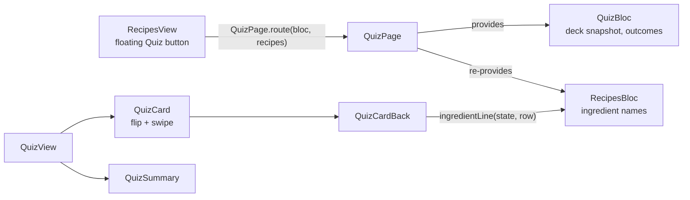
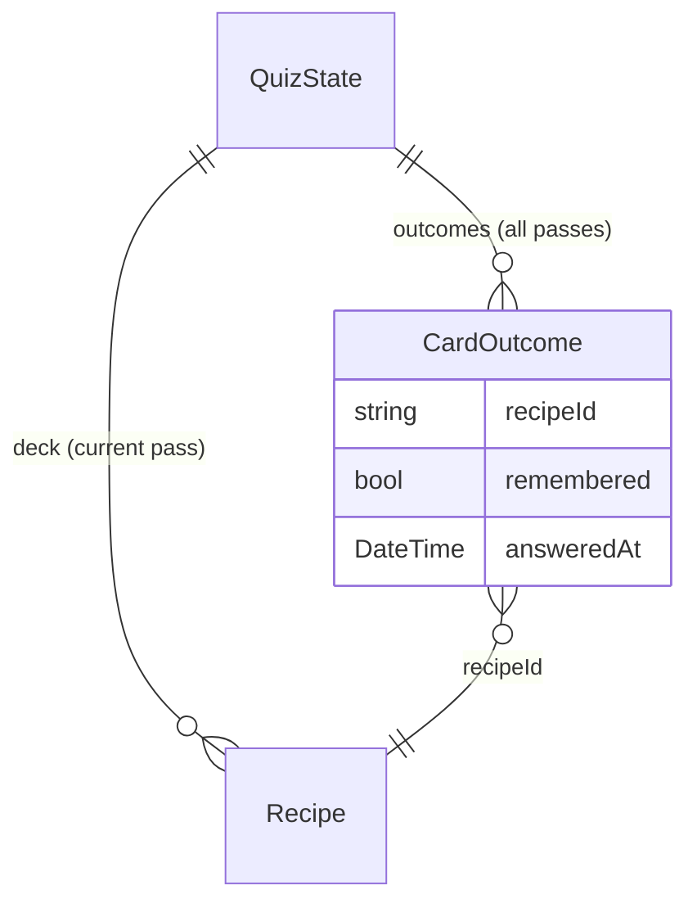

## feat: add flash-card quiz - Standard

> Source: `docs/brainstorm/2026-11-11-flash-card-quiz-brainstorm-doc.md`. Its key decisions
> are the requirement. This plan settles its open questions (see the table below) and the gaps
> a user-flow analysis found. It is built in three phases, each one commit that leaves the app
> green at 100% coverage.

## Overview

The first study mode. From the recipe list, a floating **Quiz** button starts a flash-card
pass over every recipe in the active library, shuffled. A card shows the recipe **name**.
Tapping it flips the card to the **ingredients with amounts, then the steps**. Once flipped,
the user grades themselves:

- swipe **right** or tap **Remembered**
- swipe **left** or tap **Didn't remember**

After the last card, a summary shows the score and lists the missed recipes. **Retry
missed** starts a new pass with only those. **Done** returns to the list.

Nothing is persisted. Every grade appends a `CardOutcome(recipeId, remembered, answeredAt)`
to quiz state. That record is the shape a later tracking feature will store, so tracking
can be added without reworking the quiz flow.

## Problem Statement / Motivation

The app exists to help the user memorize recipes. So far it only lets them manage recipes.
Flash cards are the simplest self-check that works on any library, whatever its schema.

## Proposed Solution

### Open questions from the brainstorm, settled here

| Question | Answer |
|---|---|
| Swipe implementation | **Custom gesture.** `GestureDetector` horizontal drag plus an `AnimationController`. No new dependency, so no license check. |
| Entry point | **A floating button** on the recipe list, shown only when the active library has at least one recipe. `FScaffold` has no FAB slot, so the button sits in a `Stack` over the list. |
| Thin recipes | **Kept in the deck.** An empty section reads a muted `No ingredients` / `No steps`. |
| Reusable ingredient display | The details page's private `_ingredientLine` becomes a top-level `ingredientLine(RecipesState, Ingredient)` in `lib/recipes/widgets/ingredient_line.dart`, following `schemaFieldText`. The details page and the card back both call it. |
| Leaving mid-session | **Pop freely** before the first grade of a pass and on the summary. **Once a card in the running pass is graded**, leaving asks through `showConfirmDialog`. |
| Do retry outcomes count toward tracking? | Deferred to the tracking feature. The log keeps every outcome either way. |

### Decisions made in this plan

- **The deck is the whole active library** and ignores the list's search text and tag
  filter. This follows the brainstorm. The snapshot is `List<Recipe>`, taken when the button
  is tapped and passed to the route.
- **Ingredient names resolve live.** The card back reads the catalog through `RecipesBloc`,
  as the details page does. A catalog ingredient deleted mid-session drops its row. The
  recipe snapshot itself does not change.
- **`No ingredients` is decided from the resolved rows**, not from the raw list. A recipe
  whose catalog entries were all deleted therefore never shows a heading over nothing.
- **The flip is one-way.** The back repeats the recipe name as its title, so the user never
  needs to flip back.
- **Buttons grade immediately.** Only a swipe animates the card off. Retry missed
  reshuffles.
- **A double grade is impossible by construction:**
  - The bloc ignores a grade unless the current card is flipped. A grade resets `flipped`,
    so a second tap does nothing.
  - The card is keyed on `(passStart, index)`. When ✓ is tapped during a fly-off, the old
    card's state and controller are disposed, so its completion never fires.
- **`canPop` changes with state.** It is `true` until a card in the running pass is graded,
  so the iOS edge swipe and Android back pop freely. After that it is `false`, and
  `onPopInvokedWithResult` asks for confirmation. The editor's always-false pattern would
  turn off iOS swipe-back even when there is nothing to lose. A retry pass with no grades
  yet pops without asking. The summary and retry are states of the one route, so back never
  returns to an earlier summary.
- **Focus and announcements**, so screen-reader and keyboard users are never stranded:
  - The front is an `FTappable(autofocus: true)` with a button role, and Enter or Space
    flips it.
  - On a flip, the back's title takes focus and is a header in a live region. Without that,
    focus would go with the disposed front.
  - After a grade, the new card's front autofocuses. Its key is new.
  - `Card N of M` and the summary score are live regions.
  - There are no keyboard shortcuts for grading; the buttons cover keyboard users.
- **When everything is remembered**, the summary shows a short congratulation in place of
  the missed list, and no Retry missed button.
- **`Random` and the clock are injected** into `QuizBloc`, so tests are deterministic. These
  are the app's first injected randomness and time.

### Architecture



`QuizBloc` depends on nothing but the recipes it is given. It reads no repository and
writes nothing.

### Data model

`CardOutcome` is feature-local and lives in `bloc/`, exported by `quiz_bloc.dart`. It moves
to a package once tracking persists it.



### `lib/quiz/` layout

```
lib/quiz/
  quiz.dart                      # barrel
  bloc/card_outcome.dart         # final class CardOutcome extends Equatable
  bloc/quiz_bloc.dart            # + part quiz_event.dart, quiz_state.dart; exports card_outcome.dart
  view/quiz_page.dart            # QuizPage.route(), providers
  view/quiz_view.dart            # PopScope, header, progress, card or summary, grade buttons
  widgets/quiz_card.dart         # front/back, tap-to-flip, drag/fly-off/spring-back
  widgets/quiz_card_back.dart    # name, Ingredients, Steps (empty labels)
  widgets/quiz_summary.dart      # score, missed list, Retry missed / Done
```

### Bloc

```dart
QuizBloc({
  required List<Recipe> recipes,   // asserted non-empty; the entry point guarantees it
  Random? random,                  // one instance shuffles the first pass and every retry
  DateTime Function() now = DateTime.now,
})
```

Use `sealed class QuizEvent extends Equatable`, `final class` for each event and for
`QuizState`, and private `_random` and `_now` fields.

| Event | Effect | Ignored when |
|---|---|---|
| `QuizCardFlipped` | `flipped = true` | already flipped, or the pass is finished |
| `QuizCardGraded(remembered:)` | appends `CardOutcome(currentRecipe.id, remembered, now())`, `index++`, `flipped = false` | the card is not flipped, or the pass is finished |
| `QuizMissedRetried` | `deck = missedRecipes` reshuffled, `index = 0`, `passStart = outcomes.length` | the pass is not finished, or nothing was missed |

`QuizState(deck, index, flipped, outcomes, passStart)` exposes these getters:

- `isFinished`: `index >= deck.length`
- `currentRecipe`: `Recipe?`
- `rememberedCount`
- `missedRecipes`: in answer order
- `hasGradedInPass`

The current pass's slice of `outcomes` is private.

### Tasks

#### Phase 1: Quiz bloc

- [ ] `lib/quiz/bloc/card_outcome.dart`, and `lib/quiz/bloc/quiz_bloc.dart` with its
  `quiz_event.dart` and `quiz_state.dart` parts, as specified above.
- [ ] `lib/quiz/quiz.dart` barrel, exporting the bloc for now.
- [ ] Tests, using `bloc_test` with `Random(seed)` and a fixed `now`:
  - **`quiz_state_test.dart`**:
    - `isFinished` and `currentRecipe`, which is null when finished.
    - `rememberedCount` and `missedRecipes`, counting only the current pass and keeping
      answer order.
    - `hasGradedInPass`, including at the start of a retry pass.
  - **`quiz_event_test.dart`**: props, following `starter_catalog_event_test.dart`.
  - **`quiz_bloc_test.dart`**:
    - The initial deck is a permutation of the input, and a seeded `Random` gives a stable
      order.
    - Flip sets `flipped`. Flip when flipped or finished emits nothing.
    - Grading an unflipped card emits nothing. Grading appends `CardOutcome` with `now()`,
      advances and unflips.
    - Grading the last card finishes the pass. Grading after finish emits nothing.
    - Retry before finish, or with nothing missed, emits nothing.
    - Retry builds a deck of exactly the missed recipes and resets the index. The outcomes
      keep both passes.
    - A single-card deck works.

#### Phase 2: Quiz screens (not yet linked)

- [ ] Move `RecipeDetailsPage._ingredientLine` into the top-level
  `String? ingredientLine(RecipesState state, Ingredient row)` in
  `lib/recipes/widgets/ingredient_line.dart`. Move its doc comment with it, then export the
  file from `recipes.dart`.
- [ ] Switch the details page to the helper, unchanged in behavior.
- [ ] `lib/quiz/view/quiz_page.dart`: `QuizPage.route({required RecipesBloc bloc, required
  List<Recipe> recipes})`. It uses `RouteSettings(name: 'quiz')` and a `MultiBlocProvider`
  that re-provides `bloc` and creates `QuizBloc`.
- [ ] `lib/quiz/view/quiz_view.dart`:
  - `PopScope(canPop: isFinished || !hasGradedInPass)`. When a pop is blocked,
    `onPopInvokedWithResult` asks through `showConfirmDialog`, then pops if the user
    confirms.
  - `FHeader.nested` with a back action that calls `maybePop`, and the title `quizTitle`.
  - The progress line, in `Semantics(liveRegion: true)`.
  - `QuizCard`, keyed on `(passStart, index)`.
  - Below the card, two `FButton`s, disabled until flipped: `Didn't remember` (outline,
    prefix `FLucideIcons.x`) and `Remembered` (prefix `FLucideIcons.check`).
  - `QuizSummary` once `isFinished`.
- [ ] `lib/quiz/widgets/quiz_card.dart`:
  - Front: an `FCard` with the name and the visible `quizRevealHint` (`ExcludeSemantics`).
    It is wrapped in `FTappable(autofocus: true, semanticsLabel: name)` with
    `Semantics(onTapHint: quizRevealAction)`.
  - Back: `QuizCardBack`, scrollable for long step lists.
  - Flip: an `AnimatedSwitcher` with a Y-axis rotation transition.
  - Drag is attached only when flipped. The card translates with the finger and tilts in
    proportion to the offset.
  - On release past `swipeDistanceFraction` (0.35) of the card width, or on a fling faster
    than `swipeVelocity` (800 px/s), the card flies off and then calls `onGraded(dx > 0)`.
    Otherwise it springs back. The thresholds are named constants the tests reference.
  - Further drags are ignored during a fly-off. A drag cancel springs back.
  - Every animation uses `Duration.zero` when `MediaQuery.disableAnimationsOf` is true. The
    fly-off completion checks `mounted`.
- [ ] `lib/quiz/widgets/quiz_card_back.dart`:
  - The recipe name, wrapped in `Focus(autofocus: true)` and
    `Semantics(header: true, liveRegion: true)`.
  - The Ingredients section, titled with `RecipeSectionTitle`. It has one line per non-null
    `ingredientLine`, or a muted `quizNoIngredients` when no row resolves.
  - The Steps section, numbered `1.`, `2.`, …, or `quizNoSteps`.
  - All gaps use `AppSpacing` tokens.
- [ ] `lib/quiz/widgets/quiz_summary.dart`:
  - The score, `quizSummaryScore`, in `Semantics(liveRegion: true)`.
  - The `quizSummaryMissedTitle` list of names in answer order, keyed by recipe id. When
    nothing was missed, `quizSummaryAllRemembered` replaces the list.
  - `quizRetryMissedLabel`, a primary button shown only when something was missed. It
    dispatches `QuizMissedRetried`.
  - `quizDoneLabel`, which pops. It is primary when nothing was missed, outline otherwise.
- [ ] Add the view, page and widgets to the barrel.
- [ ] Strings in `lib/l10n/arb/app_en.arb`. Every key has a description, and placeholders
  are `int`, following `starterCatalogImportLabel`:

  | Key | Value |
  |---|---|
  | `quizTitle` | `Quiz` |
  | `quizProgressLabel` | `Card {current} of {total}` |
  | `quizRevealHint` | `Tap to reveal` |
  | `quizRevealAction` | `reveal the recipe` |
  | `quizNoIngredients` | `No ingredients` |
  | `quizNoSteps` | `No steps` |
  | `quizForgotLabel` | `Didn't remember` |
  | `quizRememberedLabel` | `Remembered` |
  | `quizSummaryScore` | `{remembered} of {total} remembered` |
  | `quizSummaryAllRemembered` | `{total, plural, =1{You remembered it!} other{You remembered all {total}!}}` |
  | `quizSummaryMissedTitle` | `Missed` |
  | `quizRetryMissedLabel` | `Retry missed` |
  | `quizDoneLabel` | `Done` |
  | `quizLeaveTitle` | `Leave the quiz?` |
  | `quizLeaveDescription` | `Your progress in this pass will be lost.` |
  | `quizLeaveConfirm` | `Leave` |
  | `quizKeepGoingLabel` | `Keep going` |

- [ ] Tests. Widget tests use `pumpApp` with `_MockRecipesBloc` (state built from
  `test/helpers/fixtures.dart`) and `_MockQuizBloc` (`MockBloc`, with
  `whenListen`/`when(() => bloc.state)`), as `starter_catalog_page_test.dart` does.
  - **`test/recipes/widgets/ingredient_line_test.dart`**: a full row, a row with no
    quantity or unit, and an unknown `catalogId` that yields null.
  - **`recipe_details_page_test.dart`**: the existing ingredient-name cases pass unchanged.
  - **`quiz_page_test.dart`**: the route is named `quiz` and renders `QuizView` over a real
    `QuizBloc`. The route is otherwise unlinked until phase 3.
  - **`quiz_view_test.dart`**:
    - The progress text, as a live region.
    - Grade buttons disabled before the flip, enabled after. Each dispatches its grade.
    - After a grade, the new card's front has focus.
    - The summary replaces the card when finished.
    - Back before any grade pops with no dialog. Back after a grade shows the dialog; Keep
      going stays and Leave pops.
    - Back on the summary, or in a retry pass with nothing graded yet, pops with no dialog.
  - **`quiz_card_test.dart`**:
    - Tap flips, and so does Enter on the focused front. The front's label and hint.
    - A drag before the flip does nothing.
    - A drag past the distance threshold grades right as remembered and left as not.
    - A short fling grades.
    - A short drag, or a drag cancel, springs back without grading.
    - With `disableAnimations`, a swipe grades with nothing left to pump.
    - Tapping ✓ during a fly-off records exactly one outcome.
  - **`quiz_card_back_test.dart`**:
    - The back's title has focus after the flip.
    - Ingredient lines show amounts, and steps are numbered.
    - `No ingredients` and `No steps` show for an empty recipe, and `No ingredients` shows
      when every row's catalog entry is gone.
    - Fields, tags and notes are absent.
  - **`quiz_summary_test.dart`**:
    - The score is shown, as a live region.
    - Missed names are listed in order.
    - Retry missed shows only when something was missed, and it dispatches.
    - Done pops.
    - The all-remembered variant, for one card and for several.

#### Phase 3: Entry point and docs

- [ ] In `_RecipeList` (`lib/recipes/view/recipes_view.dart`), wrap the `Expanded` child in a
  `Stack`. When `libraryRecipes.isNotEmpty`, add a compact `FButton` at
  `Positioned(right: 0, bottom: AppSpacing.spacing200)`:
  - `mainAxisSize: min`, prefix `FLucideIcons.layers`, label `quizStartLabel` (`Quiz`).
  - It pushes `QuizPage.route(bloc:, recipes: libraryRecipes)`.
- [ ] Add the string `quizStartLabel`.
- [ ] `recipes_view_test.dart`:
  - No Quiz button for an empty library.
  - The button shows with recipes, and also when the search filters the list to nothing.
  - Tapping it pushes `quiz` with every recipe of the active library.
- [ ] Add a `docs/known-issues.md` entry: *A quiz session is lost when the user leaves.* It
  covers what is lost, why (tracking is the next slice), and what closing it involves.

## Technical Considerations

- **The floating button overlaps the list.** `FTileGroup` has no scroll padding, so at
  maximum scroll the last tile sits under the button. The button is a compact pill at the
  bottom-end. It covers only the trailing side of the tile, which stays tappable. A long name
  runs under the pill. Manual step 2 checks whether that is acceptable. If not, the fix is a
  bottom spacer sized to the pill.
- **The keyboard.** With search focused, `FScaffold` resizes for the inset, so the button
  rides above the keyboard.
- **Gesture arena.** The back scrolls vertically inside a horizontal drag detector. Flutter's
  arena separates the two axes, so no custom recognizer is needed.
- **iOS edge swipe and the card's swipe.** Before the first grade `canPop` is true, so a
  drag that starts in the screen's left edge strip pops the route. The card sits inside the
  page padding, so a swipe that starts on the card grades. Manual step 5 confirms this.
- **Layering.** `lib/quiz` imports `recipes_repository` (for `Recipe` and `Ingredient`) and
  `lib/recipes`, never a data package.
- **Lifecycle.** Backgrounding keeps the session in memory. If the OS kills the process, the
  session is lost, which is consistent with nothing being persisted.
- **Performance and security.** Decks are library-sized. Nothing is persisted or sent
  anywhere.

## Implementation Phases

### Phase 1: Quiz bloc

- **Status:** Done
- **Scope:** `CardOutcome` and `QuizBloc`: the shuffled deck snapshot, the flip and grade
  guards, the outcome log and Retry missed. It is pure Dart, and no UI is wired yet.
- **Files touched:** `lib/quiz/quiz.dart`, `lib/quiz/bloc/card_outcome.dart`,
  `lib/quiz/bloc/quiz_bloc.dart`, `lib/quiz/bloc/quiz_event.dart`,
  `lib/quiz/bloc/quiz_state.dart`, `test/quiz/bloc/quiz_bloc_test.dart`,
  `test/quiz/bloc/quiz_event_test.dart`, `test/quiz/bloc/quiz_state_test.dart`
- **Acceptance criteria:** Every Phase 1 test case passes, and the app stays at 100%
  coverage.
- **Validation:** `flutter analyze && dart format --output=none --set-exit-if-changed . && dart run bloc_tools:bloc lint . && very_good test --coverage --min-coverage 100`

### Phase 2: Quiz screens

- **Status:** Done
- **Scope:** The shared `ingredientLine` helper, and the quiz page, view, card, card back,
  summary and strings. The route works, but nothing links to it yet.
- **Files touched:** `lib/recipes/widgets/ingredient_line.dart`, `lib/recipes/recipes.dart`,
  `lib/recipes/view/recipe_details_page.dart`, `lib/quiz/quiz.dart`, `lib/quiz/view/*`,
  `lib/quiz/widgets/*`, `lib/l10n/arb/app_en.arb`,
  `test/recipes/widgets/ingredient_line_test.dart`, `test/quiz/view/*`,
  `test/quiz/widgets/*`
- **Acceptance criteria:** Every Phase 2 test case passes. The details page behaves the same.
  Coverage is 100%.
- **Validation:** `flutter pub get && flutter gen-l10n && flutter analyze && dart format --output=none --set-exit-if-changed . && dart run bloc_tools:bloc lint . && very_good test --coverage --min-coverage 100 && ! grep -q "_ingredientLine" lib/recipes/view/recipe_details_page.dart`

### Phase 3: Entry point and docs

- **Status:** Done
- **Scope:** The floating Quiz button on the recipe list, its tests, and the known-issues
  entry. The feature becomes reachable here.
- **Files touched:** `lib/recipes/view/recipes_view.dart`, `lib/l10n/arb/app_en.arb`,
  `test/recipes/view/recipes_view_test.dart`, `docs/known-issues.md`
- **Acceptance criteria:** The full verification command passes, and the manual device check
  passes.
- **Validation:** the `VERIFICATION COMMAND` below, then the manual steps in Success Criteria.

## Success Criteria

```success-criteria
GOAL: From the recipe list of a non-empty library, a user can run a shuffled flash-card pass over every recipe in it, flipping each card from name to ingredients-with-amounts and steps, grading it by swipe or button, then see a score with the missed recipes and retry only those, with every grade recorded as a CardOutcome in quiz state and nothing persisted.

SUCCESS CRITERIA:
- Localized strings generate and the app analyzes cleanly | verify: flutter pub get && flutter gen-l10n && flutter analyze
- Code is formatted | verify: dart format --output=none --set-exit-if-changed .
- Bloc lints pass | verify: dart run bloc_tools:bloc lint .
- App, bloc and widget tests pass at 100% coverage, covering every case in the three phases' test lists | verify: very_good test --coverage --min-coverage 100
- No dependency was added | verify: git diff --quiet main -- pubspec.yaml
- The quiz persists nothing and never reaches a data package | verify: ! grep -rqE "shared_preferences|RecipesRepository|package:recipes_api|package:local_storage_recipes_api" lib/quiz
- The details page and the card back share one ingredient-line formatter | verify: ! grep -q "_ingredientLine" lib/recipes/view/recipe_details_page.dart && grep -q "ingredientLine(" lib/quiz/widgets/quiz_card_back.dart
- The lost-session limitation is recorded | verify: grep -q "quiz session is lost" docs/known-issues.md
- The feature works end to end on a device | verify: manual 1) run `flutter run --flavor development --target lib/main_development.dart` 2) on an empty library confirm there is no Quiz button; import or add 3+ recipes (one with no ingredients and no steps, one with a long name) and confirm the floating Quiz button appears bottom-right, the last tile stays tappable beside it at full scroll, and a long name under it is acceptable 3) type a search that matches nothing and confirm the button is still there; tap it and confirm "Card 1 of N" with N = every recipe in the library 4) confirm both grade buttons are disabled and a horizontal drag does nothing; tap the card and confirm the name, ingredient lines with amounts and numbered steps, and that the thin recipe reads No ingredients / No steps 5) swipe one card right, flick one left, drag one a little and release to see it spring back, and use the buttons for the rest 6) mid-pass after a grade, press back and confirm the Leave dialog; Keep going stays, Leave returns to the list 7) restart, finish a pass with misses, confirm the score and missed names, tap Retry missed and confirm only those come back; back out before grading and confirm no dialog 8) finish with everything remembered and confirm the congratulation, no Retry missed, and that Done returns to the list; on iOS, edge-swipe back before the first grade and confirm it pops 9) enable Reduce Motion / Remove animations, run a pass, and confirm cards flip and leave instantly 10) with TalkBack or VoiceOver, confirm the card reads its name with the reveal hint, the back's title is read after flipping, "Card N of M" is announced after each grade, and the whole pass can be completed with the buttons alone

NON-GOALS:
- Persisting outcomes, success/failure rates, or resurfacing weak recipes (the tracking feature)
- Deciding whether Retry missed outcomes count toward tracking
- Undo, a count picker, hand-picked or tag-filtered decks, or other quiz directions/modes
- Keyboard shortcuts for grading
- Showing library field values, tags or notes on the card back
- Resuming a session after leaving or after the app is killed

VERIFICATION COMMAND: flutter pub get && flutter gen-l10n && flutter analyze && dart format --output=none --set-exit-if-changed . && dart run bloc_tools:bloc lint . && very_good test --coverage --min-coverage 100 && git diff --quiet main -- pubspec.yaml && ! grep -rqE "shared_preferences|RecipesRepository|package:recipes_api|package:local_storage_recipes_api" lib/quiz && ! grep -q "_ingredientLine" lib/recipes/view/recipe_details_page.dart && grep -q "ingredientLine(" lib/quiz/widgets/quiz_card_back.dart && grep -q "quiz session is lost" docs/known-issues.md
```

## Success Metrics

- A pass over a 20-recipe library takes under five minutes with one hand.
- Every pass can be completed without a swipe. The tests prove it.

## Dependencies & Risks

- **Depends on** the starter recipes import (#20, merged), only for a realistic deck to test
  against by hand.
- **The flip and swipe animations are the riskiest code**, mainly for test flakiness.
  Covering them at 100% needs `pump(duration)` stepping and the `disableAnimations` branch,
  which is why the thresholds are named constants.
- **Swipe tuning.** 0.35 of the width and 800 px/s are starting values. Manual step 5 is
  where they get adjusted.
- **Focus on flip.** Autofocus inside an `AnimatedSwitcher` can race the outgoing child. If
  the widget test shows focus landing on the old front, request focus in a post-frame
  callback instead.

## References & Research

- Bloc, page `route()` and re-provided `RecipesBloc` pattern:
  `lib/starter_catalog/view/starter_catalog_page.dart` and `lib/starter_catalog/bloc/`.
  Tests are in `test/starter_catalog/`.
- Ingredient line to extract: `_ingredientLine` in
  `lib/recipes/view/recipe_details_page.dart`. Its top-level helper precedent is
  `schemaFieldText` in `lib/recipes/widgets/schema_field_value.dart:20`.
- Pop guard pattern: `lib/recipes/view/recipe_editor_page.dart:169` and `_onPopInvoked`
  (`:320`), plus `lib/ui/confirm_dialog.dart`.
- Header actions and list area: `lib/recipes/view/recipes_view.dart`.
- Plural ARB pattern: `starterCatalogImportLabel` in `lib/l10n/arb/app_en.arb`.
- Test harness: `test/helpers/pump_app.dart` and `test/helpers/fixtures.dart`.
- forui 0.27.4:
  - `FTappable` has `autofocus` and activates on Enter or Space through `ActivateIntent`.
  - `FScaffold` has no FAB slot.
  - `FTileGroup` has no scroll padding.
- Product intent (flashcards as a study mode): `docs/plan.md` §2, which is superseded for the
  stack only.
